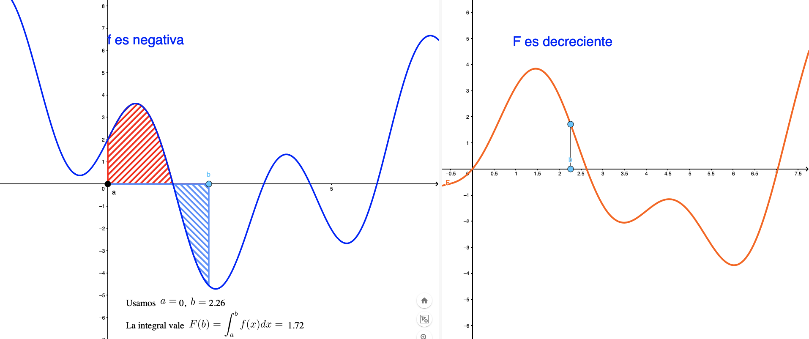

---

**Sesión 15. Teorema Fundamental del Cálculo.**

{width="80%" fig-align="center"}


+ [Notebook de la sesión en Colab](https://colab.research.google.com/drive/1G2UoBXU1OYCRhg9fOvUem2QRorbKmE89?usp=sharing)


---

```{=latex}
  
  \frametitle{Tabla de contenidos}
  \tableofcontents

```


# Introducción

\small

Como indica el nombre de la sesión, el resultado central que vamos a ver es uno de los más importantes del Cálculo. Mediante el Teorema Fundamental del Cálculo vamos a establecer un puente entre las dos ideas básicas que hemos discutido hasta ahora: la derivada y la integral. Y una vez tendido ese puente veremos como poder utilizarlo para, por un lado, hacer posible el cálculo exacto del valor de muchas integrales importantes. Por otro lado, este resultado ilumina la importancia del *cálculo de primitivas*, que es la operación inversa de la derivación; pero que es, en general, considerablemente más difícil en la práctica (cuando es siquiera posible, ya precisaremos esto). Aunque esa labor se ha simplificado enormemente en las últimas décadas, sigue siendo imprescindible para cualquier ingeniero, científico (y en general, cualquier persona cultivada) adquirir los fundamentos básicos del cálculo de primitivas. Que además son el punto de partida de la teoría de las Ecuaciones Diferenciales, sumamente importante en las aplicaciones del Cálculo y que forma parte de vuestro plan de estudios.

\normalsize

::: {.callout-warning  appearance="minimal"}

###  \textcolor{red}{Advertencia: no te obsesiones con el cálculo de primitivas.} 

Esta sesión contiene bastante material y ejercicios sobre cálculo de primitivas. Pero lo único necesario es que alcances un nivel básico de familiaridad con estos métodos. En la práctica, harás estas operaciones siempre apoyándote en un ordenador.

:::

# Teorema Fundamental del Cálculo {.fragile}

::: {.callout-note  icon=false}

## Otra vez, integración de funciones que cambian de signo.

\small

Recuerda una vez más la construcción GeoGebra que hemos usado para ilustrar la aditividad de los intervalos 
$$\int_a^b f(x)\,dx = \int_a^c f(x)\,dx\, + \int_c^b f(x)\,dx$$ 
Y usamos esa construcción para motivar la idea de funciones definidas mediante integrales. En esta sesión vamos a profundizar en esa idea con una nueva [\textcolor{blue}{construcción GeoGebra}](https://www.geogebra.org/m/ujmkkkuh) en la que visualizaremos conjuntamente la gráfica de una función $f(x)$ que toma valores positivos y negativos, junto con la gráfica de la función asociada:
$$F(x) = \int_a^x f(t)\,dt $$


\normalsize

:::

--- 

\centering
{align="center" width="50%"}

::: {.callout-note  icon=false}

## Signo de $f$ y comportamiento de $F$

\small

Después de jugar un rato con esa construcción GeoGebra habrás observado que:

+ La función $F(x)$ es **creciente** en los intervalos en los que $f(x)$ es **positiva**. 
+ La función $F(x)$ es **creciente** en los intervalos en los que $f(x)$ es **negattiva**. 

Si te hubiéramos pedido que rellenaras los puntos suspensivos en estas dos frases

+ La función $F(x)$ es **creciente** en los intervalos en los que $\ldots\ldots$ es **positiva**. 
+ La función $F(x)$ es **creciente** en los intervalos en los que $\ldots\ldots$ es **negattiva**. 

¿qué habrías dicho? Esa idea es la motivación del siguiente teorema.

\normalsize

:::

--- 

::: {.callout-note  icon=false}

## Teorema Fundamental del Cálculo

\small

Sea $f(x)$ una función integrable en $[a, b]$ y sea 
$$F(x) = \int_a^x f(t)\, dt$$
Entonces:

+ $F(x)$ es **continua** en $[a, b]$
+ Si **$f(x)$ es continua** en un punto $x_0$ de $[a, b]$, entonces **$F(x)$ es derivable** en $x_0$ y se tiene 
$$F'(x_0) = f(x_0)$$

\normalsize

:::

\quad

\small

**Observación:** Como habíamos visto en los ejemplos previos, la función integral $F(x)$ es *"mejor"* que la $f(x)$. Si $f(x)$ tiene una discontinuidad de salto en $x_0$, $F(x)$ es continua en ese punto. Si $f(x)$ no tiene derivada en $x_0$, $F(x)$ sí es derivable (y $F'(x_0) = f(x_0)$). 

\normalsize

---

::: {.callout-tip  appearance="minimal"}

\small

\textbf{\textcolor{blue}{Ejercicio 15A01.}} Sea
$$
f(x) =
\begin{cases}
x & \text{si } 0 \leq x \leq 1 \\
x^2 & \text{si } 1 < x \leq 2
\end{cases}
$$
y sea 
$$F(x) = \int_0^x f(t)\,dt$$ 
Estudiar la continuidad y derivabilidad de $F(x)$ en el intervalo $[0,2]$. Expresar $F(x)$ en forma no integral.

\quad

\textbf{\textcolor{blue}{Ejercicio 15A02.}}  Haz lo mismo con 
$$
f(x) =
\begin{cases}
0 & \text{si } 0 \leq x \leq 1 \\
1 & \text{si } 1 < x \leq 2
\end{cases}
$$

\normalsize
:::

# Regla de Barrow y primitivas 

::: {.callout-note  icon=false}

## Un ejemplo introductorio

\small

Hasta ahora, salvo en los casos más sencillos, sólo sabemos **aproximar el valor de una integral**. El TFC abre la puerta a calcular muchas integrales de forma **exacta**. Empezamos con una observación sencilla.  
Si se cumple $F'(x) = G'(x)$ para todo $x$, entonces esas dos  funciones se diferencian sólo en una constante 
$$G(x) = F(x) + c$$
Pensemos ahora en calcular $\int_0^{\pi/2}\cos(t)\,dt$. Si definimos:
$F(x) = \displaystyle\int_0^x\cos(t)\,dt$  
entonces queremos calcular $F(\pi/2)$. El TFC dice que $F'(x) = \cos(x)$. Pero ¿conoces alguna *otra función* $G(x)$ tal que $G'(x) = \cos(x)$? Naturalmente, $G(x) = \sin(x)$. Es decir, $F'(x) = G'(x)$ y por tanto $F(x) = G(x) + c$. Así $F(\pi/2) = G(\pi/2) + c = \sin(\pi/2) + c = 1 + c$. ¿Cómo nos libramos de $c$? Usando que $F(0) = \int_0^0 \cos(t)\,dt = \sin(0) + c$. Es decir $c = 0$. En conclusión, hemos obtenido un valor exacto de la integral:
$$F(\pi/2) = \int_0^{\pi/2}\cos t\, dt = 1$$ 

\normalsize


:::


---

::: {.callout-note  icon=false}

## Regla de Barrow y primitivas

\small

Sea $F(x)$ una **primitiva** de $f(x)$. Es decir, que $F'(x) = f(x)$. Entonces la **Regla de Barrow** dice que (el último símbolo define una abreviatura de uso frecuente):
$$
\int_a^b f(t)\,dt = F(b) - F(a) \overset{\text{def}}{=}  \left[F(x)\right]_a^b
$$
\normalsize


:::

\small 
**Explicación:** la idea es la que hemos visto, con un pequeño embrollo de nombres entre $F$ y $G$ causado por la notación tradicional. Si esto te resulta confuso, pasa a la siguiente página.  
Definimos $G(x) = \displaystyle\int_a^x f(t)\,dt$  y queremos calcular $G(b)$. Observamos que por el TFC, esta función $G$ es una primitiva de $f$. Ahora buscamos *otra primitiva* $F(x)$ de $f$ (con una fórmula más sencilla sin integrales). Y observamos que $F(x) = G(x) + c$. Así 
$$
\begin{cases}
F(b) = G(b) + c\\
F(a) = G(a) + c
\end{cases}\quad
\text{ y restando: }
G(b) - G(a) = F(b) - F(a) 
$$
Pero $G(a = 0)$ y $G(b) = \int_a^b f(t)\, dt$. Sustituyendo esto en la última ecuación se obtiene la Regla de Barrow.

\normalsize


--- 


::: {.callout-tip  appearance="minimal"}

\small

\textbf{\textcolor{blue}{Ejercicio 15A03.}} Hallar la temperatura media de una barra metálica situada en el eje X de extremos $x=1$ y $x=4$, siendo $T(x) = 2x^3$ la temperatura en cada punto $x$ de la misma. ¿Sabrías hacerlo (sin ayuda del ordenador) si fuera $T(x) = 20\,Ln(x)$? Indicación: para la segunda versión necesitas *integración por partes*. 

\quad 

\textbf{\textcolor{darkgreen}{Ejercicio 15C01.}} Comprueba estos resultados con el notebook de la sesión.

\quad 

\textbf{\textcolor{blue}{Ejercicio 15A04.}} Calcula 
$$\int_0^1\dfrac{1}{1 + x^2}\, dx$$
Usa las propiedades de las integrales para demostrar que para todo $n = 0, 1, 2, \ldots$ se tiene
$$\left|\int_0^1\dfrac{1}{1 + x^2}\, dx\right|\le \dfrac{\pi}{4}$$

\quad 

\textbf{\textcolor{firebrick}{Ejercicios Hoja 3B GITI 25-26.}} 3 y 4.


\normalsize

:::

# Derivación de funciones definidas por integrales y aplicaciones


::: {.callout-note  icon=false}

## Reglas de derivación de funciones definidas por integrales

\small

Como consecuencia de la Regla de la Cadena y del Teorema Fundamental del Cálculo, se obtienen las siguientes reglas de derivación de funciones definidas por integrales:
$$\begin{array}{l}
G(x) = \int_x^b f(t)\,dt \quad \Rightarrow \quad G'(x) = -f(x)\\[3mm]
R(x) = \int_a^{\varphi_2(x)} f(t)\,dt \quad \Rightarrow \quad R'(x) = f(\varphi_2(x))\,\varphi_2'(x)
\\[3mm]
S(x) = \int_{\varphi_1(x)}^b f(t)\,dt \quad \Rightarrow \quad S'(x) = -f(\varphi_1(x))\,\varphi_1'(x)\\[3mm]
T(x) = \int_{\varphi_1(x)}^{\varphi_2(x)} f(t)\,dt \quad \Rightarrow \quad T'(x) = f(\varphi_2(x))\,\varphi_2'(x) - f(\varphi_1(x))\,\varphi_1'(x)
\end{array}$$

\normalsize

:::

\small

**Observación:** No memorices estas fórmulas, practícalas. Derivar integrales es muy fácil, pero requiere un poco de entrenamiento.

\normalsize

---

::: {.callout-tip  appearance="minimal"}

\textbf{\textcolor{blue}{Ejercicio 15A05.}} Calcular la derivada de las siguientes funciones:
$$
F(x) = \int_0^{x^2} \frac{e^t}{1+t}\,dt
\qquad
F(x) = \int_{\sin x}^{2} \frac{e^t}{1+t}\,dt
\qquad
F(x) = \int_{x^2}^{x^3} \frac{e^t}{1+t}\,dt
$$

\quad

\textbf{\textcolor{firebrick}{Ejercicios Hoja 3B GITI 25-26.}} 5.  

\quad

\textbf{\textcolor{blue}{Ejercicio 15A06.}} Estos ejercicios aprovechan lo fácil que es derivar integrales para plantear nuevas versiones de problemas que ya sabes resolver:  
$(a)$ Calcular $\displaystyle \lim_{x \to 0} \frac{\displaystyle\int_0^{x^2} \sin^3 t\,dt}{x^6\,Ln(1+x^2)}$  
$(b)$ Probar que la función $F(x) = -1 + \int_0^x e^{t^2}\,dt$ tiene una sola raíz real.  
$(c)$ Hallar el polinomio de McLaurin de orden 2 de la función $F(x) = \int_0^x e^{t^2}\,dt$  
$(d)$ Hallar el orden y la parte principal del infinitésimo $F(x) = \int_0^x \dfrac{\sin t}{3 + e^t}\, dt$.

\quad

\textbf{\textcolor{firebrick}{Ejercicios Hoja 3B GITI 25-26.}} 6 a 10 (el 8 y 9 son difíciles).  

\small

:::

# Cálculo de primitivas

::: {.callout-note  icon=false}

## Terminología y constante de integración.

\small
**Integrales definidas e indefinidas**: Hemos visto que la Regla de Barrow permite reducir el cálculo exacto de integrales al problema de encontrar primitivas: 
\scriptsize
$$
\int_a^b f(x)\, dx = \left[F(x)\right]_a^b = F(b) - F(a)\quad\text{ siendo }F'(x) = f(x)
$$
\small A menudo se dice que $\int_a^b f(x)dx$ es una **integral definida** mientas que se usa $F(x) = \int f(x)dx$ para referirse a una primitiva de $f(x)$. En esos casos se dice que $\int f(x)dx$ es una **integral indefinida**. Recuerda que $\int_a^bf(x)dx$ es un número, mientras que $\int f(x)dx$ es una función.

**La constante de integración: ** Dada una primitiva $F(x)$ de $f(x)$, si $c$ es cualquier constante, la función $F(x) + c$ también es una primitiva de $f(x)$. Esto no tiene consecuencias prácticas al usar la Regla de Barrow, basta con elegir una (en general, una sencilla). Pero, como verás en Ecuaciones Diferenciales, esa **constante de integración** a veces es esencial. Por eso debes acostumbrarte a pensar y escribir:
\scriptsize
$$\int f(x)\, dx = F(x) + c$$

\normalsize

:::


---

::: {.callout-note  icon=false}

## Métodos de Cálculo de primitivas. Funciones sin primitiva elemental.

\small

Tradicionalmente la formación de los ingenieros y científicos ponía más énfasis en el aprendizaje  de diversos métodos de cálculo de primitivas. Actualmente, esos métodos se han automatizado y cualquier ordenador (incluido tu móvil) permite obtener primitivas complicadas muy rápidamente. Así que en este curso sólo veremos algunos métodos mediante ejemplos introductorios sencillos.

Es importante no obstante entender que algunas funciones no tienen primitiva sencilla, en el sentido del siguiente ejemplo. La función $f(x) = e^{-x^2}$ (también sirve $e^{x^2}$) es la conocida **campana de Gauss** y es una de las funciones más importantes en Matemáticas. Pero no existe **ninguna primitiva sencilla** de $e^{-x^2}$. 

¿Qué queremos decir con sencilla? Que se puede demostrar que no se puede expresar como una combinación *finita* de operaciones (sumas, multiplicaciones, composiciones) de funciones *elementales* (polinomios, trigonométricas, exponenciales). Fíjate en que no estamos diciendo que no tiene primitiva. El TFC garantiza que
\scriptsize
$$F(x) = \int_0^xe^{t^2}\, dt$$
\small cumple que $F'(x) = e^{x^2}$. Pero esta primitiva no sirve de gran cosa para calcular por ejemplo $\int_0^1 e^{t^2}\, dt$ usando la Regla de Barrow (¡compruébalo!).

\normalsize


:::


---

\small

**\textcolor{red}{Ejercicios de primitivas.}** [\textcolor{blue}{En Moodle encontrarás}](https://sifo.comillas.edu/course/section.php?id=3746034) una hoja de ejercicios sobre cálculo de primitivas y sus soluciones, procede del Cálculo de GITI. Aquí te recomendaremos una selección, pero puedes intentar todas las que quieras (y pedir ayuda si te atascas).

\normalsize

::: {.callout-warning  icon=false}

## Ejemplo 1: primitivas por ajuste de constantes.

\small

Para calcular $\displaystyle\int (2 - 3 x)^4\, dx$ hacemos la sustitución o cambio de variable
$$u = 2 - 3x\quad\text{ con lo que }\quad\dfrac{du}{dx} = -3\quad\text{ que escribimos }\quad du = 3 dx$$
Entonces:
$$
\int (2 - 3 x)^4\, dx = \int u^4 \dfrac{1}{3}\, dx = \dfrac{u^5}{15} = \dfrac{(2 - 3x)^5}{15}
$$
Estos cambios de variable son tan sencillos que a menudo los hacemos directamente, sin mencionar la variable $u$, y decimos que hemos hecho un *ajuste de constantes*.

\normalsize

:::

::: {.callout-tip  appearance="minimal"}

\textbf{\textcolor{blue}{Ejercicio 15A07.}} Calcular las siguientes primitivas:

\scriptsize
$$
\begin{array}{llll}
(a) \int x^5\,dx
&
(b) \int \frac{dx}{(x+4)^6}
&
(c) \int \sqrt{x}\,dx
&
(d) \int (3x+1)^4\,dx
\\[3mm]
(e) \int \frac{dx}{(2x+1)^3}
&
(f) \int \sqrt{2x+1}\,dx
&
(g) \int \frac{dx}{\sqrt{5x-2}}
&
(h) \int \frac{2x+3}{2x+1}\,dx
\end{array}
$$
:::


---

::: {.callout-warning  icon=false}

## Ejemplo 2: primitivas por partes.

\small

La regla de la derivada del producto $(u(x)v(x))' = u'(x)v(x) + u(x)v'(x)$ puede usarse para definir un método de cálculo de primitivas conocido como **integración por partes**:
\scriptsize
$$
\int u(x)\,v'(x)\,dx = \int((u(x)v(x))')\,dx - \int u'(x)\,v(x) \,dx =  
u(x)\,v(x) - \int u'(x)\,v(x)\,dx
$$
\small
Para aplicarlo debemos ver que la función a integrar se puede considerar un producto $u(x)\,v'(x)$ y hacer
\scriptsize
$$
\left\{
\begin{array}{lcl}
u(x)  &\overset{\text{derivar}}{\longrightarrow}  & u'(x)\\[2mm]
v'(x) &\overset{\text{integrar}}{\longrightarrow} & v(x)
\end{array}
\right.
$$
\small El método no es útil cuando la *"nueva"* primitiva $u(x)'\,v(x)$ es más difícil que la original $u(x)\,v'(x)$.

Por ejemplo, para $\displaystyle x\, e^x\, dx$, hacemos: \scriptsize
$$
\left\{
\begin{array}{lcl}
u(x) = x  &\overset{\text{derivar}}{\longrightarrow}  & u'(x) = 1\\[2mm]
v'(x) = e^x &\overset{\text{integrar}}{\longrightarrow} & v(x) = e^x
\end{array}
\right.
$$
\small Luego $\displaystyle\int \underbrace{x\, e^x}_{u v'}\, dx = \underbrace{x\, e^x}_{u v} - 
\int \underbrace{1\cdot e^x}_{u' v}\, dx = x\, e^x - e^x = e^x (x - 1)$

\normalsize

:::

---

::: {.callout-tip  appearance="minimal"}

\textbf{\textcolor{blue}{Ejercicio 15A07.}} Calcular las siguientes primitivas por partes:

\small
$$
\begin{array}{llll}
(a) \int x\log(x)\,dx
&
(b) \int x\,e^{2x}\,dx
&
(c) \int \frac{x}{\cos^2(x)}\,dx
&
(d) \int x\cos^2(x)\,dx
\\[3mm]
(e) \int (2x^2+3)\,e^x\,dx 
&
(f)\int \arcsin(x)\,dx
&
(g) \int \log(x)\,dx
&
(h) \int e^x\operatorname{sen}(x)\,dx
\end{array}
$$
\normalsize

:::

::: {.callout-warning  icon=false}

## Ejemplo 3: cambios de variable directos.

\small
Dada una integral de la forma $\int f(u(x))\,u'(x)dx$ generalizamos la fórmula que hemos visto al ajustar constantes. Si introducimos una nueva variable $u = u(x)$ (abusando de la notación) entonces $du = u'(x)dx$ y por tanto podemos hacer 
$$\int f(u(x))\,u'(x)dx = \int f(u)\, du = F(u) + c = F(u(x)) + c$$
siendo $F$ una primitiva de $f$.

Por ejemplo, ante $\int \sin(x^2)\, x\, dx$ hacemos $u = x^2, du = 2\, x\, dx$ y por tanto
\scriptsize
$$\int \sin(x^2)\, x\, dx = \dfrac{1}{2}\int \sin(x^2)\, 2x\, dx = 
\dfrac{1}{2}\int \sin(u)\, du = \dfrac{-\cos(u)}{2} + c = \dfrac{-\cos(x^2)}{2} + c$$
\normalsize

:::

---

::: {.callout-tip  appearance="minimal"}

\scriptsize

\textbf{\textcolor{blue}{Ejercicio 15A08.}} Calcular las siguientes primitivas por cambio de variable directo:
$$
\begin{array}{llll}
(a) 
\int x\left(x^2+199\right)^{99} dx
&
(b) \int \dfrac{5x^2}{(6x^3+2)^3}\,dx
&
(c) \int \dfrac{3x-1}{(3x^2-2x+1)^4}\,dx
&
(d)\int \frac{x}{1+4x^2}\,dx
\\
(e) \int \tan x\,dx
& 
(f) \int 7x^2\sqrt{x^3+2}\,dx
&
(g) \int x\sqrt{(x^2+1)^3}\,dx
&
\int \frac{x}{\sqrt{1-4x^2}}\,dx
\end{array}
$$


\normalsize
:::

::: {.callout-warning  icon=false}

## Ejemplo 4: cambios de variable no directos.

\small
Hay otros cambios de variable más complejos que dependen de la forma particular de la función $f$. Aprender a usar estos cambios específicos es más laborioso y aquí sólo vamos a hacer un ejemplo. 

Dado el problema $\int \sqrt{1 - x^2}\,dx$, nos inspiramos en esta identidad trigonométrica
\scriptsize
$$
\sin^2 u + \cos^2 u = 1\Rightarrow \cos u = \sqrt{1 - \sin^2 u}\qquad (\text{ para }\cos u > 0)
$$
\small 
para hacer el cambio $x = \sin u \Rightarrow dx = \cos u\, du$ y por tanto:
\scriptsize
$$\int \sqrt{1 - x^2}\,dx = \int \cos u\cdot\cos u\, du = \int\cos^2 u du = 
\int\dfrac{1 +\cos(2u)}{2}\,du = \dfrac{u}{2} + \dfrac{\sin(2u)}{4} + c =$$
$$
= \dfrac{u}{2} + \dfrac{2\sin(u)\cos(u)}{4} + c = 
\dfrac{\arcsin(x)}{2} + \dfrac{2 x \sqrt{1 - x^2}}{4} + c 
$$
**Nota:** para integrar $\cos^2$ hemos usado las **identidades trigonométricas del ángulo doble**, que son la única forma sencilla de integrar $\sin^2$ y $\cos^2$.
\normalsize

:::


---

::: {.callout-note  icon=false}

## Ampliación: ecuaciones diferenciales 

\small

Las ecuaciones diferenciales surgen (en Física en particular) como una extensión natural del problema de Cálculo de primitivas. Si te piden que adivines qué función $f(x)$ cumple esta ecuación:
$$f'(x) = x^5$$
enseguida comprenderás que este es un problema de cálculo de primitivas y que la respuesta es
$$f(x) = \dfrac{x^6}{6} + k$$ 
con $k$ una constante cualquiera. Si a continuación te preguntan cuáles son las funciones que cumplen esto:
$$f'(x) = f(x)$$
es muy probable que adivines rápidamente que cualquier función $f(x) = k e^x$ (con $k$ constante) sirve como solución. Al hacer eso has resuelto tu primera ecuación diferencial. ¿Ves que se trata de un problema relacionado pero distinto? Para ayudarte a entender la diferencia: y si te preguntan cuál es la función que cumple
$$f''(x) - 5 f'(x) + f(x) = e^{x}$$
En la asignatura de Ecuaciones Diferenciales aprenderás a resolver problemas como este (y verás que este ejemplo en particular es muy sencillo).

\normalsize


:::
