---

**Sesión 17. Diferenciabilidad y continuidad en varias variables.**

\centering {width="80%"}

+ [Notebook de la sesión en Colab](https://colab.research.google.com/drive/11GK27MvP4d9AYIWDJp82cK7HY-yf_d2F)


---

```{=latex}
  
  \frametitle{Tabla de contenidos}
  \tableofcontents

```


# Introducción. 

\small

En la anterior sesión hemos dejado pendiente un aspecto esencial en la discusión sobre el plano tangente a una función $z = f(x, y)$ en un punto $(x_0, y_0)$. Hemos visto que, para proponer un *candidato* a plano tangente nos basta con ser capaces de calcular las derivadas parciales $f_x(x_0, y_0)$ y $f_x(x_0, y_0)$. Es decir, basta que la función sea *derivable*. Pero también hemos visto, al introducir la idea de derivadas direccionales, que **la información que proporcionan las derivadas parciales en un punto es limitada**, porque únicamente nos hablan del comportamiento de la función a lo largo de dos direcciones muy específicas (y esencialmente arbitrarias, dependen de nuestra elección de los ejes de coordenadas). 

La dificultad que subyace a esta discusión es que, al pasar de una a dos variables, la idea de límite se vuelve, seguramente de forma inesperada, mucho más complicada. Veremos en esta sesión que la idea de *acercarse a un punto* encierra muchos más matices en el caso de dimensiones más altas, cuando se compara con el caso unidimensional. 

Y esa discusión es relevante en el contexto del plano tangente, porque lo que buscamos es garantizar que el plano tangente sea una buena aproximación a la función **cuando $(x,y)$ se acerca a $(x_0, y_0)$**. Por lo tanto, para hablar cabalmente del plano tangente y no cometer errores graves, no podemos soslayar la discusión sobre límites en varias variables. 

\normalsize

# Límites y continuidad en funciones de dos variables {.fragile}

::: {.callout-note  icon=false}

## El problema con el límite en varias variables

\small

Cuando trabajamos con límites en funciones de una variable como $\displaystyle\lim_{x\to x_0}f(x)$
la mayor dificultad conceptual que parece contener el símbolo $\displaystyle\lim_{x\to x_0}$ es que en ocasiones hemos tenido que calcular dos límites laterales $\displaystyle\lim_{x\to x_0^-}f(x)$ y $\displaystyle\lim_{x\to x_0^+}f(x)$ y ver si coinciden. Sólo hay dos formas de acercarse a un punto $x\in\mathbb R$, por la izquierda o por la derecha. Al pasar a $\mathbb R^2$ las cosas camban radicalmente. Como ilustra la figura, hay infinitas formas de acercarse a $(x_0, y_0)$ en el plano. No sólo hay infinitas direcciones (rectas) que pasan por el punto. Además hay la posibilidad de acercarse por parábolas, espirales o curvas muchísimo más complicadas... 

\hfil 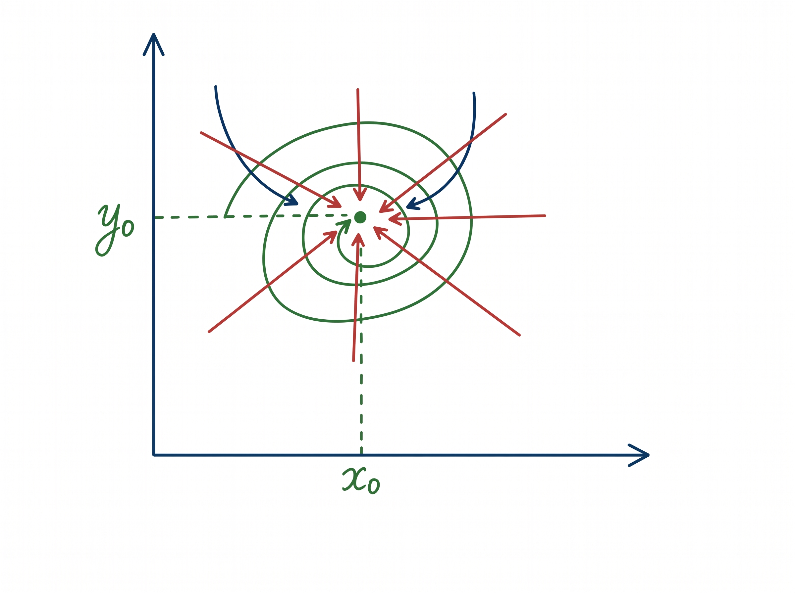{width="50%"} \hfil


\normalsize

:::

---

::: {.callout-note  icon=false}

## El problema es real y la noción de límite es muy exigente. 

\small

Ese problema hace que el símbolo $\displaystyle \lim_{(x, y)\to (x_0, y_0)}$ tenga una complejidad mayor que el límite en una variable. Por eso, cuando decimos
$$
\lim_{(x, y)\to (x_0, y_0)}f(x, y) = L
$$
estamos diciendo que podemos conseguir que los valores de $f(x, y)$ se parezcan tanto a $L$ como se quiera, si acercamos $(x, y)$ a una distancia suficientemente pequeña de $(x_0, y_0)$, **independientemente de cómo se acerque.** 


\normalsize

:::

\quad

Puedes estar preguntándote si este problema es real, o si estamos preocupándonos por algo que sólo ocurre en funciones muy *raras*. Los siguientes ejemplos tratarán de convencerte de que el problema es muy real. 


---

::: {.callout-note  icon=false}

## Continuidad

\small
Los ejemplos anteriores pueden hacernos creer que estudiar límites de funciones de varias variables es un gran problema. Y el problema, como hemos visto, es real y ocurre en funciones sencillas. Pero a menudo está localizado: en los dos ejemplos que hemos visto el problema ocurre en el origen, *y en ningún otro punto.*  

Esta última afirmación se basa en la idea de *continuidad* que es, en este caso sí, igual a la del caso de una variable. La función $f(x, y)$ es **continua** en $(x_0, y_0)$ si el límite (existe y) coincide con el valor:
$$
\lim_{(x, y)\to (x_0, y_0)}f(x, y) = f(x_0, y_0)
$$
Y la buena noticia es que la continuidad es fácil de demostrar usando los mismos métodos que ya vimos en la Sesión 3. Lo único que tienes que hacer es repasar las páginas desde *"Continuidad de algunas funciones elementales"* hasta *"Indeterminaciones"*

\normalsize

:::


::: {.callout-tip  appearance="minimal"}

\small

\textbf{\textcolor{firebrick}{Ejercicios Hoja 8B GITI 25-26.}} Ejercicio 8. No hace falta analizar ahora el punto $(0, 0)$, lo veremos más adelante. 


\normalsize

:::


---

::: {.callout-tip  appearance="minimal"}
\small

\textbf{\textcolor{blue}{Ejercicio 17A01.}} 

$(a)$ Dada la función
$$
f(x, y) = 
\begin{cases}
\dfrac{x^2 - y^2}{x^2 + y^2} & (x, y)\neq (0, 0)\\[2mm]
0  & (x, y) =  (0, 0)
\end{cases}
$$
Estudia el valor de $f$ cuando te acercas a $(0, 0)$ a lo largo del eje $X$ (por tanto $y = 0$). Haz lo mismo a lo largo del eje $Y$. Finalmente, haz lo mismo para una recta cualquiera $y = k x$ de pendiente $k$ que pase por el origen. ¿Qué observas?

$(b)$ Haz lo mismo con la función
$$
g(x, y) = 
\begin{cases}
\dfrac{x^3y}{x^6 + y^2} & (x, y)\neq (0, 0)\\[2mm]
0  & (x, y) =  (0, 0)
\end{cases}
$$
Es decir, estudia su comportamiento a lo largo de todas las rectas por el origen.


$(c)$ Ahora estudia el comportamiento de $g(x, y)$ a lo largo de la curva $y = x^3$, que también pasa por el origen. 

\textbf{\textcolor{darkgreen}{Ejercicio 17C01.}} Explora sus gráficas en estas dos construcciones GeoGebra [\textcolor{blue}{para f}](https://www.geogebra.org/classic/gjshkuue) y [\textcolor{blue}{para g}](https://www.geogebra.org/classic/nfvm4y3m). ¡Fíjate en que ambas funciones son cocientes de polinomios! 

\normalsize

:::

---


::: {.callout-note  icon=false}

## Funciones escalares de dos variables: $z = f(x, y)$

\small

Vamos a usar en muchos casos las funciones $f:\mathbb R^2\mapsto\mathbb R$ como ejemplo importante y como fuente de inspiración para otros casos más generales. Una de estas funciones tiene dos valores de entrada, que denotamos $(x, y)$ y produce un valor de salida $z$, de manera que es:
$$z = f(x, y)$$
Para visualizar estas funciones pensamos en el espacio $\mathbb R^3$. Si para cada par de valores $(x, y)$ del plano $XY$ (plano $z= 0$) pintamos el punto del espacio de coordenadas $(x, y, f(x, y))$ obtendremos la **gráfica** de $f$, que en general será una **superficie**, una especie de paisaje con montañas, hondonadas, planicies, etc. como la de debajo. Abre esta [\textcolor{blue}{construcción en Geogebra}](https://www.geogebra.org/classic/uzw8txum), la usaremos varias veces.

\centering 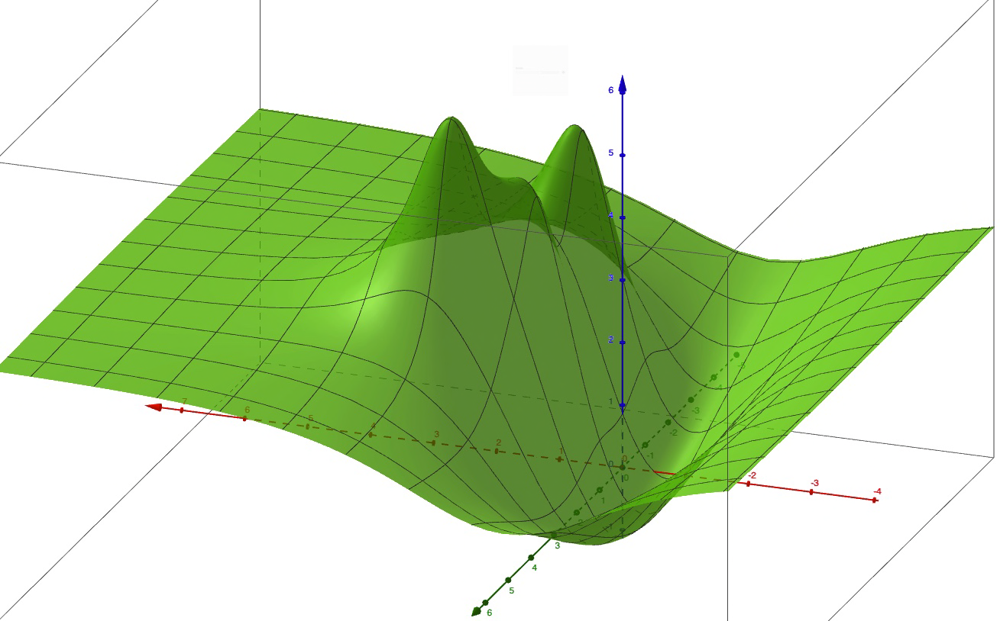{width="50%"} 

\normalsize

:::


---


::: {.callout-note  icon=false}

## Plano tangente

\small

Para estudiar las funciones de una variable $y = f(x)$ hemos insistido mucho en esa idea de hacer *zoom* en la gráfica de una función derivable hasta verla covertirse en su recta tangente. 

\hfil  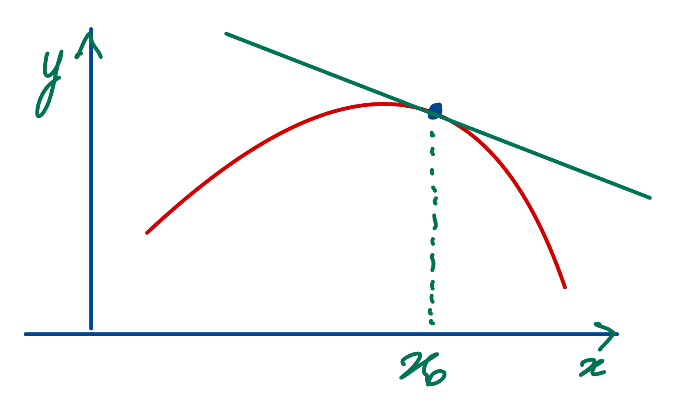{width="50%"} \hfil

Pregúntate ahora: si la gráfica de una función $z = f(x, y)$ es, como hemos dicho, una superficie ¿qué esperamos ver al hacer zoom en un punto genérico de una superficie? 

\quad

Naturalmente: un plano, el *plano tangente*.

\normalsize

:::

---


::: {.callout-note  icon=false}

## Expresión del plano tangente en términos de pendientes 

\small

Siguiendo con la analogia con las funciones de una variable, para identificar la recta tangente a una función derivable $y = f(x)$ en un punto $(x_0, f(x_0))$ lo primero que hicimos fue escribir la ecuación de esa recta así:
$$y = f(x_0) + m\cdot (x - x_0)$$
y entonces nos preguntamos cómo elegir el valor adecuado de la pendiente $m$, que resultó ser $f'(x_0)$.

Ahora queremos hacer lo mismo para $z = f(x, y)$ cerca del punto $P = (x_0, y_0, f(x_0, y_0))$. Empezando por la ecuación del plano: ¿cuántas pendientes se necesitan para identificar un plano? Es fácil ver que (casi siempre) basta con dos: la pendiente $m_x$ en la dirección del eje $X$ y la pendiente $m_y$ en la dirección del eje $Y$. Con ellas, (casi) cualquier plano por el punto $P$ se escribe:
$$z = f(x_0, y_0) + m_x\cdot (x - x_0) + m_y\cdot (y - y_0)$$
La pregunta ahora es ¿cómo elegimos $m_x$ y $m_y$ para que este plano sea el plano tangente (el que se ve al hacer zoom)? La idea básica es esta: para obtener $m_x$ hay que moverse en la dirección del eje $X$, **manteniendo fijo el valor** $y = y_0$. Usaremos la figura de la siguiente página para ilustrar esta idea.

\normalsize

:::

---

\centering 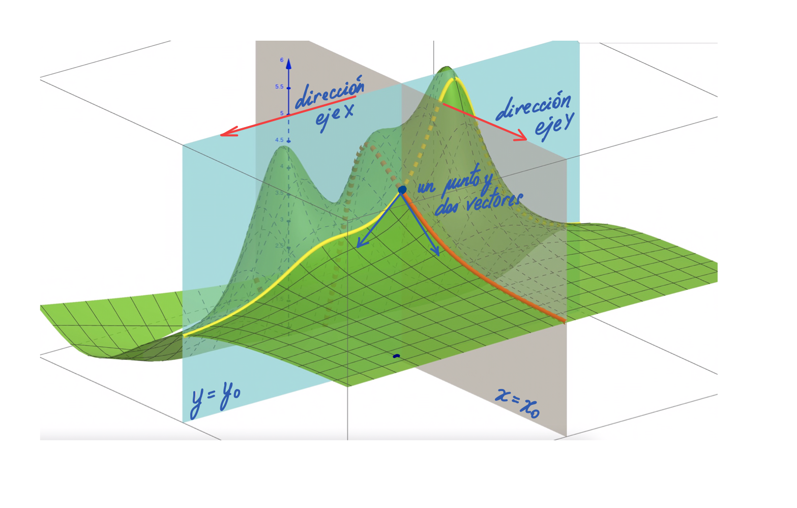{width="90%"}

---

::: {.callout-note  icon=false}

## Derivadas parciales: moivación geométrica.

\small

Vamos a pensar en detalle en cómo obtener $m_x$. Para mantener $y = y_0$ constante tenemos que pensar en la función auxiliar 
$$f(x| y = y_0) = f(x, y_0)$$ 
Esta función sólo depende de la $x$. Geométricamente, la función $f(x| y =  y_0)$ representa el corte de la gráfica de $z = f(x, y)$ con un plano vertical $y = y_0$ (paralelo al plano YZ). En el [\textcolor{blue}{notebook de la sesión}](https://colab.research.google.com/drive/1x6uAGMTwIeHT9Q7AOVyMgOQjZ3G7fvHG?usp=sharing)  ilustraremos esta idea. 

 
\hfil 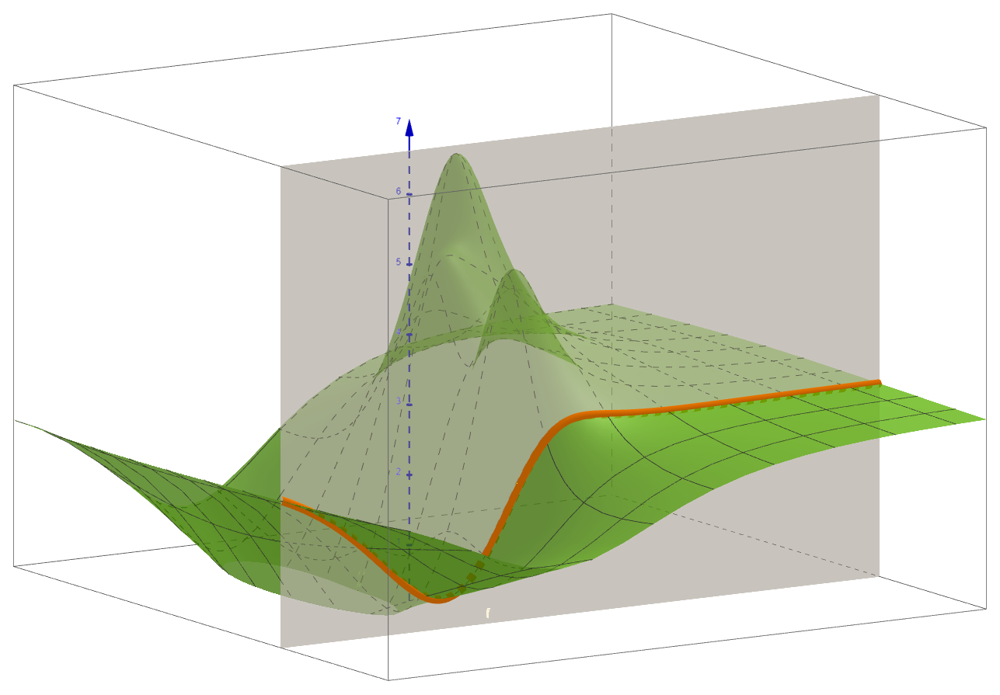{width="40%"} \hfil

Así que la pendiente $m_x$ que buscamos es la derivada de $f(x| y = y_0)$. 

\normalsize

:::

---


::: {.callout-note  icon=false}

## Derivadas parciales: definición y reglas de cálculo. Funciones derivables.

\small

Con eso, la definición de derivada parcial de $z=f(x, y)$ en $(x_0, y_0)$ es fácil: 
$$
\underbrace{\dfrac{\partial f}{\partial x}(x_0, y_0) = f_x(x_0, y_0)}_{\text{dos notaciones frecuentes}}
\quad \overset{\text{def}}=\quad 
\underbrace{\lim_{x\to x_0}\dfrac{f(x, \mathbf{y_0}) - f(x_0, \mathbf{y_0})}{x - x_0}}_{\text{Valor fijo de }y_0\text{ en numerador}}
$$

De la misma forma: $\displaystyle
\dfrac{\partial f}{\partial y}(x_0, _0) = f_y(x_0, y_0) \overset{\text{def}}= \lim_{x\to x_0}\dfrac{f(\mathbf{x_0}, y) - f(\mathbf{x_0}, y_0)}{y - y_0}
$  
suponiendo que esos límites existen. Si es así, decimos que $f(x, y)$ es **derivable** en $(x_0, y_0)$.

Pero además esta definición nos dice que no necesitamos aprender a derivar otra vez. Para calcular una derivada parcial **se aplican las mismas reglas de derivación, pero considerando la otra variable como constante.**


\normalsize

:::


::: {.callout-tip  appearance="minimal"}
\small

\textbf{\textcolor{blue}{Ejercicio 16A01.}} (a) Calcula las derivadas parciales de $f(x, y) = x^2y^3$ en $(2, 1)$ usando la definición (límite) y mediante las reglas de derivación.  
(b) Calcula las derivadas parciales de $f(x, y) = \sin\left(\dfrac{x + y}{x - y}\right)$, pero sólo mediante reglas de derivación, sin límites.
\normalsize

:::

---

::: {.callout-note  icon=false}

## Práctica de derivación parcial

\small

Calcular derivadas parciales es sencillo pero, como en el caso de una variable, requiere práctica. En [\textcolor{blue}{este enlace}](https://fsansegundo.github.io/webapp/partial-derivative-drills.html) encontrarás una aplicación web (se abre en el navegador) para ejercitarte. 

\hfil 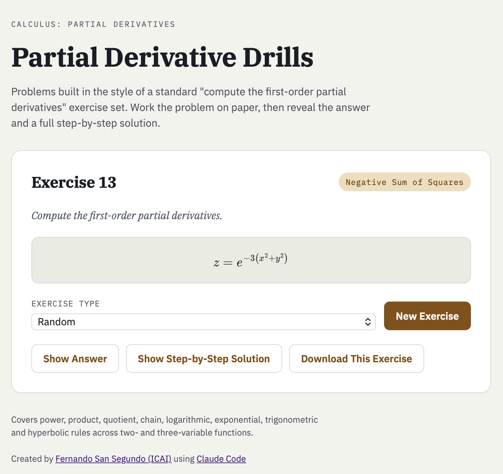{width="40%"} \hfil

+ **¡Haz el ejercicio a mano antes de ver la respuesta, no lo desperdicies!**  
+ Puedes ver la respuesta final o puedes pedir una descripción paso a paso de cómo se ha obtenido.
+ Si quieres guardar un ejemplo concreto (por ejemplo para preguntar dudas a tu profesor), puedes descargar un fichero con ese ejercicio. 

\normalsize

:::


---

::: {.callout-note  icon=false}

## De vuelta al plano tangente

\small

Ahora que sabemos describir las pendientes del plano, podemos decir que
si $f(x, y)$ es derivable en $(x_0, y_0)$, entonces nuestro **\textcolor{red}{candidato}** a plano tangente es
$$
z = f(x_0, y_0) + f_x(x_0, y_0)\cdot (x - x_0) + f_y(x_0, y_0)\cdot (y - y_0)
$$

¿Por qué decimos *candidato*? Para entender eso en detalle tendremos que esperar a la próxima sesión. Para preparar esa respuesta vamos a introducir otra idea fundamental que generaliza las derivadas parciales. 

\normalsize

:::

::: {.callout-tip  appearance="minimal"}
\small

\textbf{\textcolor{blue}{Ejercicio 16A02.}} 
(a) Calcula las derivadas parciales de 
$$f(x, y) = 
\begin{cases}
\dfrac{|x y|}{|y| + |x - y|}& (x, y)\neq (0, 0)\\[2mm]
0 &  (x, y) = (0, 0)
\end{cases}
$$ 
en $(0, 0)$ usando la definición (límite).  ¿Cuál es tu candidato a plano tangente?

$(b)$ ¿Cuánto vale ese plano candidato si $x = y$? ¿Cuánto vale $f(x, x)$? ¿Ves algún problema?

\textbf{\textcolor{darkgreen}{Ejercicio 16C01.}} Examina esta función en [GeoGebra](https://www.geogebra.org/classic/ur6rdwjq) o en el [notebook](https://colab.research.google.com/drive/1x6uAGMTwIeHT9Q7AOVyMgOQjZ3G7fvHG?usp=sharing).

\normalsize

:::


# Derivadas direccionales

::: {.callout-tip  appearance="minimal"}
\small

\textbf{\textcolor{blue}{Ejercicio 16A03.}}  
(a) ¿Cuál es el plano tangente a $f(x, y) = \sqrt{3 + x^2 + y^2}$ en $(1, 0)$?  
(b) Usa esto para aproximar $\sqrt{3 + 1.01^2 + 0.02^2}$

\normalsize

:::


::: {.callout-note  icon=false}

## Planos verticales. 

\small

Al introducir las derivadas parciales hemos visto que, por ejemplo $f_y(x_0, _0)$ se puede entender como la derivada de la función (de una variable) $f(y | x = x_0)$. A su vez, la gráfica de esta función es el corte de la superficie gráfica de $z = f(x, y)$ con el *plano vertical* $y = y_0$, paralelo al plano $YZ$.

Pero hay muchos otros planos verticales que pasan por el punto $(x_0, y_0, f(x_0, y_0))$, aparte de los dos planos $x = x_0$ e $y = y_0$. ¿Cómo es la ecuación de uno de esos planos verticales? Una en la que no aparece la $z$:
$$A (x -x_0) + B (y - y_0) = 0$$
En esta [\textcolor{blue}{construcción GeoGebra}](https://www.geogebra.org/classic/ghnqjfqp) puedes experimentar con esta idea. Y en las siguientes figuras exploraremos la geometría de esta situación con más detalle. 

\normalsize

:::

---

\hfil 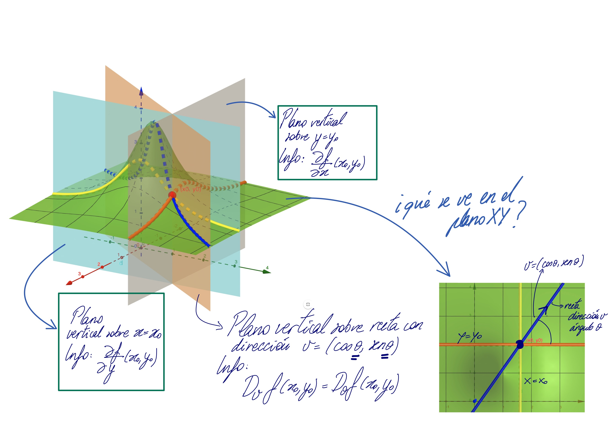{width="100%"} \hfil

---

::: {.callout-note  icon=false}

## Ecuación en función del ángulo con el semieje $x > 0$

\small

La ecuación del plano horizontal $XY$ es $z = 0$. Fijado el punto $(x_0, y_0)$, un plano vertical por ese punto queda caracterizado por su recta de corte con $z = 0$

\hfil 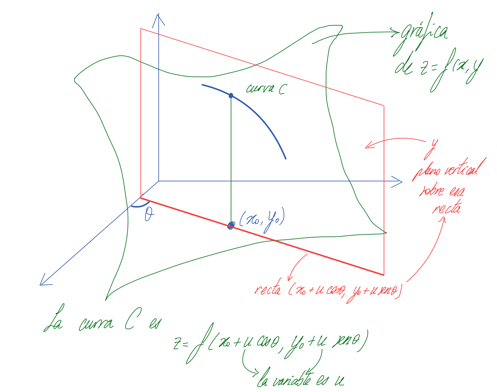{width="40%"} \hfil

Sea $\theta$ el ángulo que esa recta del plano $XY$ hace con el semieje $x > 0$. La pendiente de la función $f(x, y)$ en la dirección de esa recta es la **derivada direccional** de $f$ en ese punto y se representa mediante:
$$D_{\theta}f(x_0, y_0)$$
En la figura de la página anterior la pendiente de la curva naranja es $f_x(x_0, y_0)$, la de la curva amarilla es $f_y(x_0, y_0)$ y la de la curva azul es $f_y(x_0, y_0)$.

\normalsize

:::

---


::: {.callout-note  icon=false}

## Definición formal de  derivadas direccionales mediante límites

\small

Las ecuaciones paramétricas de la recta del plano $XY$ que hace un ángulo $\theta$ con el semieje $x > 0$ son:
$$
\begin{cases}
x = x_0 + u\cdot\cos \theta_0\\[2mm]
y = y_0 + u\cdot\sin\theta_0
\end{cases}
\qquad\text{ Fíjate en que si }u = 0\text{ estás en }(x_0, y_0)
$$
Los valores de la función a lo largo de la recta son entonces:
$$f(x_0 + u\cdot\cos\theta_0, y_0 + u\cdot\sin\theta_0)$$
La **derivada direccional** correspondiente se define entonces así:

$$D_{\theta}f(x_0, y_0) 
\, \overset{\text{def}}= \, 
\lim_{x\to x_0}\dfrac{f(x_0 + u\cdot\cos\theta_0, y_0 + u\cdot\sin\theta_0) - f(x_0, y_0)}{u}
$$
En próximas sesiones veremos un método más directo para calcular $D_{\theta}f(x_0, y_0)$.

\normalsize

:::


::: {.callout-tip  appearance="minimal"}

\textbf{\textcolor{blue}{Ejercicio 16A04.}} Halla las derivadas parciales y las direccionales de $f(x, y) = x^2 + y^2$ en $(x_0, y_0) = (1, 2)$ para un ángulo cualquiera $\theta$. ¿Cuánto valen $D_{0}f(1, 2)$, $D_{\pi}f(1, 2)$, $D_{\pi/2}f(1, 2)$ y $D_{-\pi/2}f(1, 2)$?


\normalsize

:::

# Otros tipos importantes de funciones $f:\mathbb R^n\mapsto\mathbb R^m$

Nos vamos a fijar mucho en las funciones $z = f(x, y)$ porque podemos visualizar sus gráficas y usar eso para desarrollar la intuición necesaria. Pero no queremos cerrar esta sesión sin adelantar algunos otros ejemplos importantes que vamos a encontrar.

::: {.callout-note  icon=false}

### Funciones escalares de dimensiones más altas.

\small

Una función *escalar* que nos da la temperatura en cada punto del espacio será $T = T(x, y, z)$, es decir $T:\mathbb R^3\mapsto\mathbb R$. No puedes visualizar esta función como una gráfica, pero puedes imaginarte algo así como un termómetro en cada punto del espacio, como trata de sugerir la figura.

\hfil 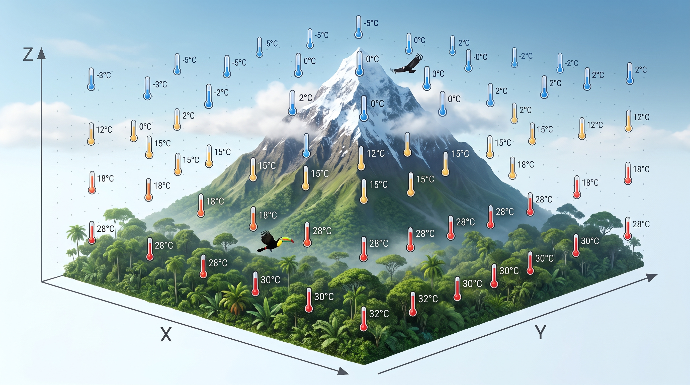{width="40%"} \hfil

Si la temperatura cambia con el tiempo serán cuatro variables de entrada $T = T(x, y, z, t)$. Aquí tienes [\textcolor{blue}{ejemplos climáticos}](https://www.floodradar.co.uk/el-nino/tracker).

\normalsize

:::

---

::: {.callout-note  icon=false}

### Curvas paramétricas

\small

Antes hemos usado las ecuaciones paramétricas de una recta que sirven para calcular $(x, y)$ a partir del parámetro $u$. Es decir, $u\mapsto (x,y)$. En general, una **curva paramétrica** en el plano es $c(u) = (x(u), y(u))$; se trata de una función $c:\mathbb R\mapsto\mathbb R^2$. Una curva en el espacio sería $c:\mathbb R \mapsto \mathbb R^3$. 

En Física se usan mucho este tipo de curvas para describir la *trayectoria* de un cuerpo que se mueve. En ese caso el parámetro de la curva es el tiempo, y en lugar de $u$ lo común es usar la variable $t$. Es decir, por ejemplo en el caso plano, para cada instante de tiempo $t$ queremos la posición $(x(t), y(t))$ del cuerpo que se mueve. 

\hfil 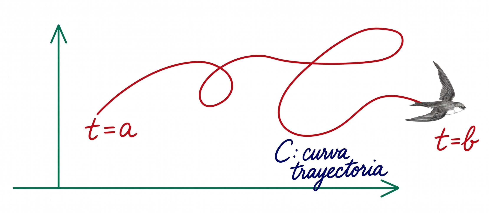{width="60%"} \hfil

En $\mathbb R^3$ la curva sería $c(t) = (x(t), y(t), z(t))$. ¿Cómo crees que se calculan la velocidad y aceleración en esta trayectoria?  
Aparte de curvas paramétricas, hay *superficies paramétricas*. ¿Se te ocurre un ejemplo? Pista: latitud, longitud.


\normalsize

:::


---

::: {.callout-note  icon=false}

### Campos de vectores

\small

Has estudiado en Física que, de acuerdo con la Ley de la Gravedad de Newton, una partícula de masa $m$ situada en un punto del espacio (supongamos por conveniencia que es el origen) crea en cada punto $(x, y, z)$ del espacio una fuerza $\vec F$ de atracción. Pero  $\vec F$, siendo un vector en el espacio, tiene tres componentes: $\vec F = (F_1, F_2, F_3)$. Así que el campo gravitatorio es, desde el punto de vista del Cálculo, una **función vectorial**
$$\vec F(x, y, z) = (F_1(x, y, z), F_2(x, y, z), F_3(x, y, z))$$
es decir, $\vec F:\mathbb R^3\mapsto\mathbb R^3$. 

En Meteorología es frecuente dibujar mapas que muestran en cada punto un pequeño vector que indica la velocidad del viento, como en esta imagen

\hfil 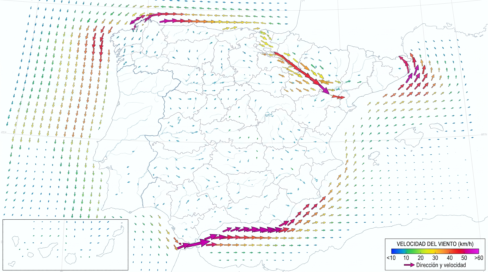{width="35%"} \hfil

Naturalmente, el viento (o la gravedad, o el campo eléctrico) cambian con el tiempo, como puedes ver [\textcolor{blue}{en este ejemplo}](https://es.windfinder.com/#8/70.4506/29.2429). ¿Cómo afecta eso a la función que define el campo?

\normalsize

:::


---

::: {.callout-note  icon=false}

### Cambios de variables

\small

Cuando queremos identificar un punto $P$ del plano podemos dar sus *coordenadas cartesianas* $(x, y)$. Pero también podemos dar sus *coordenadas polares* $(r, \theta)$ como se ilustra en la figura:

\hfil 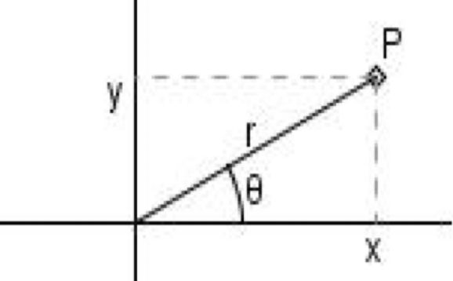{width="20%"} \hfil

La relación entre $(x, y)$ por un lado y $(r, theta)$ por otro se establece con estas **ecuaciones del csmbio de variables:**
$$
\begin{cases}
x = r\cos\theta\\[2mm]
y = r\sin\theta
\end{cases}
$$
Y está claro que esto se puede ver como una función $\mathbb R^2\mapsto\mathbb R^2$. Los cambios de variable (en dos, tres o más dimensiones)  resultan extremadamente útiles, a veces imprescindibles, para resolver con éxito muchos problemas. Por ejemplo, la gravedad se describe mal en cartesianas y es mucho más sencilla en otras coordenadas.

\normalsize

:::

\small

**Pregunta:** En el campo de velocidades del viento en un mapa, quiénes son $m$ y $n$ en $\mathbb R^n\mapsto\mathbb R^m$? ¿Y en el cambio a coordenadas polares?

\normalsize

---

::: {.callout-note  icon=false}

### Álgebra Lineal. Y más allá...

\small

Podríamos seguir así, poniendo ejemplo tras ejemplo. Queremos invitarte a pensar por ejemplo, en las *aplicaciones lineales* que estudias en Álgebra Lineal. Se trata de aplicaciones $\mathbb R^n\mapsto\mathbb R^m$ que, como decíamos en la introducción llevan 
$$
(x_1, \ldots, x_n)\longrightarrow (y_1, \ldots, y_m)
$$ 
mediante una matriz $A$ de forma $(m, n)$. Estas aplicaciones del Álgebra son especialmente importantes porque son sencillas y porque sirven para describir el tipo de objetos y comportamientos que esperamos ver cuando, como hemos hecho en varias ocasiones, hacemos *zoom* en un punto de un objeto complicado.

\quad

Y hay mucho más. Cuando miras una imagen en tu pantalla, cada pixel (dos coordenadas) muestra una combinación RGB de tres colores (de rojo, verde, azul en inglés) para enseñarte la imagen o el vídeo que estás mirando. ¿Puedes imaginar qué tipo de funciones describen esas imágenes? Un modelo de lenguaje de Inteligencia Artificial se puede ver como una función en la que entran miles o millones de variables y salen otras tantas, que codifican nuestras preguntas y sus respuestas.

\normalsize

:::

\small

Lo idea central que queremos que transmitan todos estos ejemplos es que mediante el lenguaje de las funciones, podrás aplicar los métodos del Cálculo y el Álgebra a la solución de una enorme variedad de problemas en la Ciencia y la Técnica. 

\normalsize