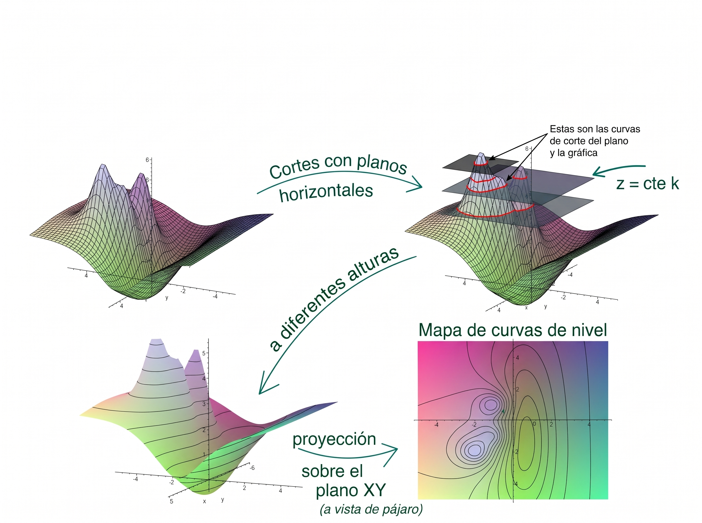
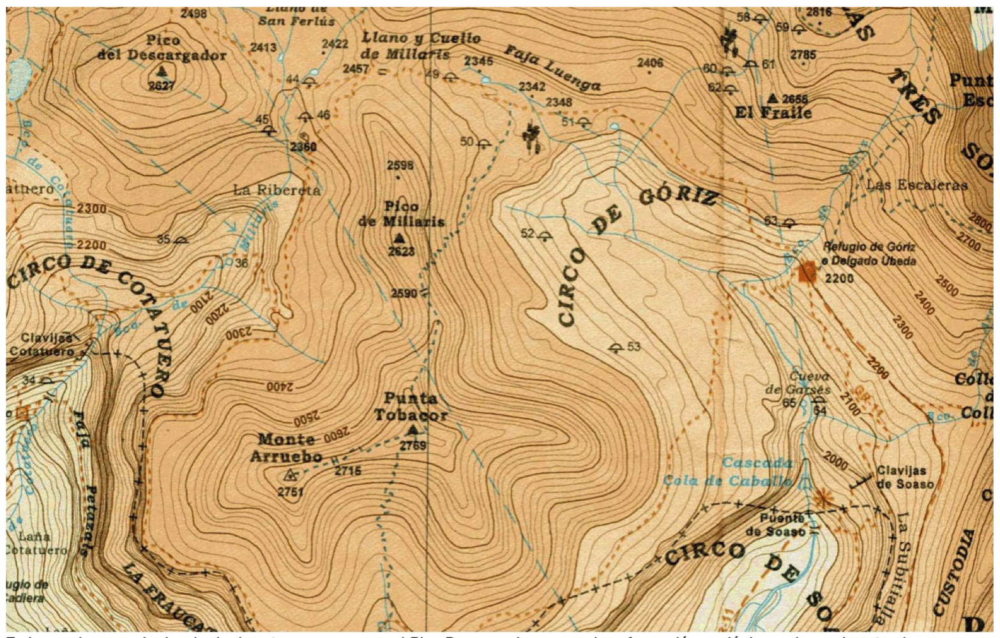
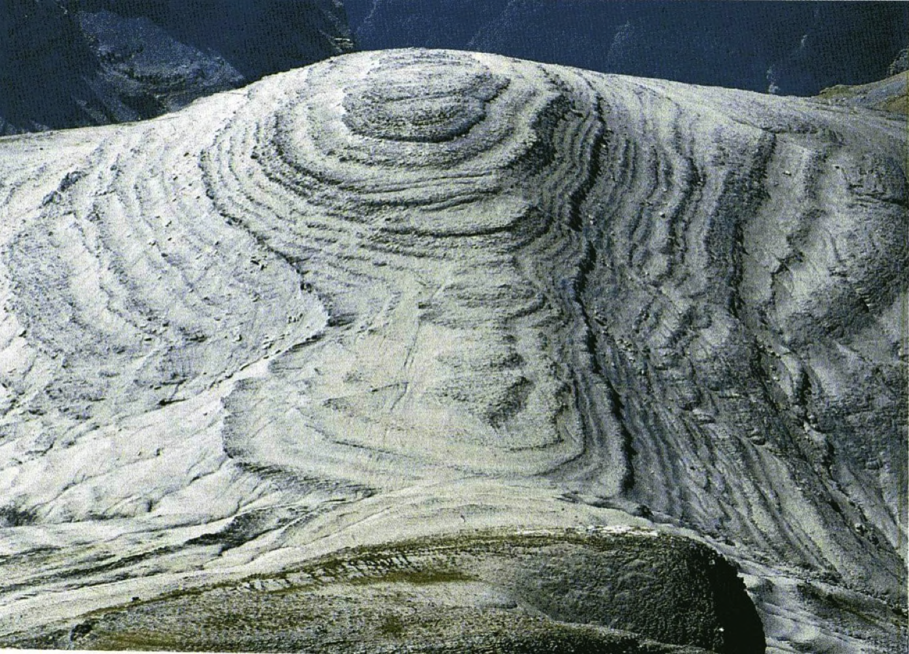
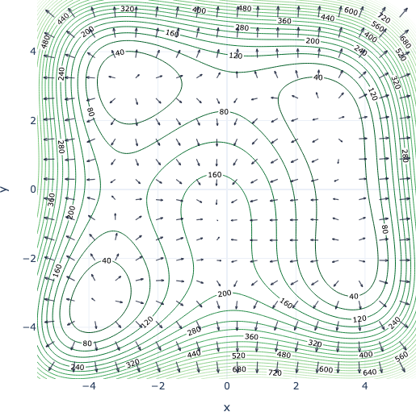

---

**Sesión 18.  Curvas de nivel y gradiente.**

\centering {width="80%"}

<!-- + [Notebook de la sesión en Colab: usamos el mismo de la anterior sesión](https://colab.research.google.com/drive/1x6uAGMTwIeHT9Q7AOVyMgOQjZ3G7fvHG?usp=sharing) -->


---

```{=latex}
  
  \frametitle{Tabla de contenidos}
  \tableofcontents

```


# Introducción. 

\small

Para estudiar el plano tangente hemos usado cortes de la gráfica de $z = f(x, y)$ con planos *verticales*. Eso nos ha llevado a la noción de derivadas parciales y direccionales. En esta sesión vamos a ver que los cortes con planos *horizontales* conducen también a un concepto  muy útil, el de curvas de nivel de la función.  

\quad

Además, vamos a introducir la idea de *gradiente*. Este vector, en el caso de funciones diferenciables, reúne la información conjunta de las derivadas direccionales de la función. Como veremos, nos proporciona así una especie de brújula con la que dirigir nuestro recorrido por la gráfica de la función en procesos de optimización iterativos. Esta propiedad del gradiente le hace protagonista del método llamado precisamente *descenso del gradiente*, que es la pieza clave en el algoritmo de entrenamiento de los modelos actuales de Inteligencia Artificial. Es esencial por lo tanto que entiendas las propiedades del gradiente.

\quad

Además conectaremos ambas nociones, las curvas de nivel y el gradiente. De esa forma, el tema central de esta sesión es el flujo de información entre el plano $XY$ de las variables de entrada y la gráfica de la función en el espacio tridimensional. 

\normalsize

# Curvas de nivel {.fragile}

::: {.callout-note  icon=false}

## Cortes con planos horizontales

\small

Un **plano horizontal** en el espacio tridimensional $XYZ$ tiene una ecuación de la forma 
$$z = k,\text{ para alguna constante }k$$
Por ejemplo, el plano $XY$ es el plano $z = 0$. La pregunta que queremos hacernos es la siguiente. Y es muy importante no perder de vista dónde vive cada uno de los protagonistas de la pregunta: ¿qué puntos (x, y) **del plano $XY$** producen valores de $z = f(x, y)$ iguales a $k$?  Esos puntos del plano XY forman la **curva de nivel $k$** de la función $z = f(x, y)$, que llamaremos $L_k(f)$:
$$L_k(f) = \{(x, y)\in\mathbb R^2 : f(x, y) = k\}$$
La relación con los planos horizontales **del espacio** se ilustra en la figura de la siguiente página y en [\textcolor{blue}{esta construcción GeoGebra}](https://www.geogebra.org/classic/jkank9sj) que ya hemos usado antes.

Como veremos, la idea más útil es pensar en (el mapa de) las curvas de nivel que se obtienen cuando **consideramos diferentes valores de $k$**. Es decir, cuando pensamos en los cortes a diferentes alturas.

\normalsize

:::

---

\hfil {width="95%"} \hfil

---


::: {.callout-note  icon=false}

## Ejemplo clásico: los mapas topográficos.

\small

La figura de abajo muestra una parte de un mapa topográfico del Parque Nacional (de la *Editorial Alpina*, especializada en este tipo de mapas de montaña). 

\hfil {width="70%"} \hfil

En el mapa aparecen las curvas de nivel, algunas rotuladas con la altura en metros a la que se encuentran esos puntos del mapa. Un usuario habituado a este tipo de mapas puede usar esas curvas para *leer el terreno*, localizar cumbres, trazar rutas, etc. El *Pico Descargador* que aparece en la esquina de arriba a la izquierda es un ejemplo geológico curioso, puedes ver la foto a continuación.

\normalsize

:::

---

Pico Descargador, en el [Parque Nacional de Ordesa]().

\hfil {width="90%"} \hfil

---

::: {.callout-note  icon=false}

## ¿Cómo se construyen las curvas de nivel?

\small

Para obtener el mapa de curvas de nivel de $z = f(x, y)$:

$(1)$ Elegimos varios valores de la *con sensatez*.  
$(2)$ Para cada $k$ escribimos la ecuación de $L_k(f):  f(x, y)= k$  
$(3)$ Identificamos esa curva del plano y dibujamos juntas las curvas que vamos obteniendo.  
$(4)$ Usar ese mapa de curvas para visualizar la gráfica (el paisaje) de $z = f(x, y)$ en $\mathbb R^3$.  

Los pasos $(1)$ a $(3)$ sólo utilizan el plano $XY$, no hay nada tridimensional en ellos. Porque, insistimos, la **curva de nivel vive en el plano $XY$**. Un error común consiste en confundir esa curva del plano con la curva en el espacio que se obtiene al cortar la gráfica de $z = f(x, y)$ con el plano $z = k$. Las dos curvas están relacionadas, pero son objetos distintos.


\normalsize

:::


::: {.callout-tip  appearance="minimal"}
\small

\textbf{\textcolor{blue}{Ejercicio 18A01.}} Dibuja el mapa de curvas de nivel de $f(x, y) = x^2 + y^2$ y visualiza su gráfica en $\mathbb R^3$.  Haz lo mismo con $g(x, y) = x^2 - y^2$

\textbf{\textcolor{darkgreen}{Ejercicio 18C01.}} Explora su gráficas en estas construcciones GeoGebra [\textcolor{blue}{para f}](https://www.geogebra.org/classic/htxejkta) y [\textcolor{blue}{para g}](https://www.geogebra.org/classic/dawy5ygf). 

\textbf{\textcolor{blue}{Ejercicio 18A02.}} Estudia la gráfica de  $h(x, y) = \sqrt{x^2 + y^2}$. **Pista:** compara el perfil vertical $h(x, 0)$ con el de $f(x, 0)$ del 18A01.

\normalsize

:::

# Gradiente

::: {.callout-note  icon=false}

## Definición del gradiente. Relación con las derivadas direccionales.

\small

Si existen las derivadas parciales de $z = f(x, y)$ en $(x_0, y_0)$ entonces el **gradiente** de $f$ en ese punto es:
$$
\underbrace{\operatorname{grad}(f)(x_0, y_0) = \nabla f(x_0, y_0) }_{\text{notación}}
\quad \overset{\text{def}}=\quad
\left(\dfrac{\partial f}{\partial x}(x_0, y_0), 
\dfrac{\partial f}{\partial y}(x_0, y_0)\right)
$$
**Si además $f$ es diferenciable** en $(x_0, y_0)$, entonces se cumple la **ecuación de coherencia** para las derivadas direccionales. Esta ecuación es consecuencia directa de la existencia de un plano tangente válido:
$$
D_{\theta}f(x_0, y_0) = 
\dfrac{\partial f}{\partial x}(x_0, y_0) \cos\theta +  
\dfrac{\partial f}{\partial y}(x_0, y_0) \sin\theta =
\underbrace{\nabla f(x_0, y_0)\cdot (\cos\theta, \sin\theta)}_\text{producto escalar}
$$

\normalsize

:::

::: {.callout-tip  appearance="minimal"}

\textbf{\textcolor{blue}{Ejercicio 18A03.}} Vuelve a hacer (mucho más rápidamente) el ejercicio 16A04. Pero asegúrate de justificar bien tu trabajo.

\normalsize

:::

---

\small

El símbolo $\nabla$ (se lee "nabla") se asocia a menudo con el *operador* vectorial que usaremos más adelante al hablar de Cálculo Vectorial
$$
\scriptsize
\nabla
\quad \overset{\text{def}}=\quad
\left(\dfrac{\partial }{\partial x}, 
\dfrac{\partial }{\partial y}\right)
$$

\normalsize

::: {.callout-note  icon=false}

## Propiedades del gradiente. 

\small

Si $f$ es diferenciable en $P = (x_0, y_0)$:

$(a)$ La derivada direccional máxima de $f$ en $P$ es igual al módulo del gradiente:
$$\max_{\theta}D_{\theta}f(x_0, y_0) = \sqrt{f_x^2(x_0, y_0) + f_y^2(x_0, y_0)}$$
$(b)$ Además esa derivada direccional máxima, que es la dirección del plano $XY$ en la que $f$ crece más rápido, es una dirección paraela al gradiente.

$(c)$ En direcciones perpendiculares al gradiente la derivada direccional es 0; es decir, $f$ ni sube ni baja en esas direcciones. 

Además, un *vector normal* al plano tangente en $(x_0, y_0)$ es 
$$\scriptsize N_{(x_0, y_0)}(f) = (f_x(x_0, y_0),  f_y(x_0, y_0), -1)$$

\normalsize

:::

::: {.callout-tip  appearance="minimal"}
\small

\textbf{\textcolor{darkgreen}{Ejercicio 16C01.}} Usa [\textcolor{blue}{Geogebra}](https://www.geogebra.org/classic/rsxtfgas) para explorar esas propiedades del gradiente.

\normalsize

:::


---


::: {.callout-tip  appearance="minimal"}

\textbf{\textcolor{blue}{Ejercicio 18A04.}} Sea $f(x, y)$ una función tal que $\nabla f(1, 2) = (1, 3)$. Supongamos que has calculado la siguiente derivada direccional (usando la definición con el límite) $D_{\pi/4}f(1, 2) = \sqrt{2}$. ¿Puede $f$ no puede ser diferenciable en $(1, 2)$?

\textbf{\textcolor{firebrick}{Ejercicios Hoja 8B GITI 25-26.}} Ejercicios 13, 14, 15 y 16.

\normalsize

:::

::: {.callout-note  icon=false}

## Relación entre el gradiente y las curvas de nivel

\small

Sea $f(x, y)$ una función diferenciable. Si $L_k(f)$ es la curva de nivel $k$ de la función $f$, entonces en cada punto de $L_k(f)$ el gradiente es perpendicular a esa curva de nivel, como se ve en la figura. Usa [\textcolor{blue}{Geogebra}](https://www.geogebra.org/classic/rsxtfgas) para explorar esto.   
\normalsize  

\hfil {width="25%"} \hfil

:::


<!-- ::: {.callout-note  icon=false} -->

<!-- ## Plantilla -->

<!-- \small -->


<!-- \normalsize -->

<!-- ::: -->

<!-- --- -->


<!-- ::: {.callout-tip  appearance="minimal"} -->

<!-- \textbf{\textcolor{blue}{Ejercicio 18A04.}}  -->

<!-- \textbf{\textcolor{firebrick}{Ejercicios Hoja 8B GITI 25-26.}}  -->

<!-- \normalsize -->

<!-- ::: -->
