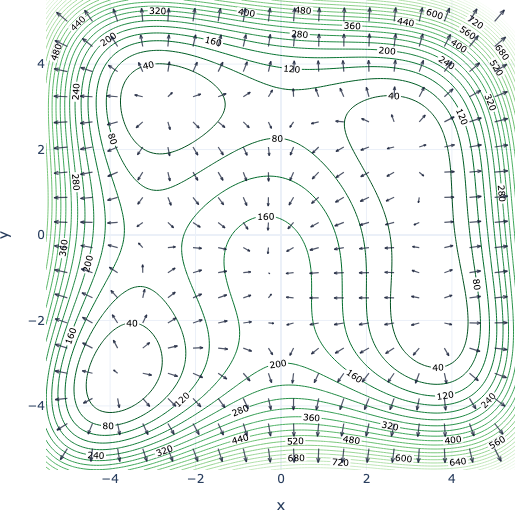

---

**Sesión 19.  Derivadas de orden superior. Regla de la Cadena.**

\centering {width="80%"}

<!-- + [Notebook de la sesión en Colab: usamos el mismo de la anterior sesión](https://colab.research.google.com/drive/1x6uAGMTwIeHT9Q7AOVyMgOQjZ3G7fvHG?usp=sharing) -->


---

```{=latex}
  
  \frametitle{Tabla de contenidos}
  \tableofcontents

```


# Introducción. 

\small

En esta sesión relativamente técnica vamos a aprender más sobre las derivadas parciales. En primer lugar, hablaremos de derivadas parciales de orden superior. Al igual que en una variable, las derivadas parciales segundas, terceras, etc permiten profundizar más en el comportamiento local de una función cuando es necesario. 
Por el camino descubriremos el lema de [Schwarz](https://es.wikipedia.org/wiki/Hermann_Schwarz), una cierta propiedad de simetría en las derivadas parciales que es nueva para nosotros porque no tiene análogo en funciones de una variable. Y pasaremos por el polinomio de Taylor en varias variables, muy brevemente porque no tenemos tiempo para tratarlo en profundidad.

Finalmente discutiremos la otra idea clave de esta sesión, la Regla de la Cadena, para derivar composiciones de funciones. Formalmente es completamente análoga a la del caso de una variable.Pero en la práctica veremos que es muy importante familiarizarse con ella, para usarla correctamente y entender la información contenida en la estructura de algunas derivadas parciales. 

\normalsize

# Derivadas de orden superior {.fragile}

::: {.callout-note  icon=false}

## Derivadas parciales segundas, terceras, etc.

\small

Una función regular como $f(x, y) = e^x\sin(y^3)$ produce dos derivadas parciales (primeras o de primer orden) como en este ejemplo:

\quad

\begin{center}
\resizebox{\diagwidth}{!}{%
\begin{tikzpicture}
  \node[fbox] (f)  {$f(x,y)=e^{x^{2}}\sen(5y)$};
  \node[fbox, above right=0.75cm and 2.4cm of f.east, anchor=west] (fx)
       {$f_x(x,y)=2x\,e^{x^{2}}\sen(5y)$};
  \node[fbox, below right=0.75cm and 2.4cm of f.east, anchor=west] (fy)
       {$f_y(x,y)=5\,e^{x^{2}}\cos(5y)$};
  \draw[flecha] (f.east) to[out=0,in=180] node[etiqueta, above left] {$\partial/\partial x$} (fx.west);
  \draw[flecha] (f.east) to[out=0,in=180] node[etiqueta, below left] {$\partial/\partial y$} (fy.west);
\end{tikzpicture}}
\end{center}

\quad

Pero las expresiones de $f_x(x,y)=2x\,e^{x^{2}}\sen(5y)$ y de $f_y(x,y)=5\,e^{x^{2}}\cos(5y)$ son de nuevo funciones regulares de dos variables, y puedes por tanto calcular sus derivadas parciales.  
La derivada $f_x(x, y)$ producirá dos derivadas parciales $f_{xx}(x, y),  f_{xy}(x, y)$.  
Y lo mismo ocurre con $f_y(x, y)$ que produce $f_{yx}(x, y), f_{yy}(x, y)$.  

La siguiente página muestra el resultado de hacer eso en este ejemplo:

\normalsize

:::

---


\small

\begin{center}
\resizebox{0.8\textwidth}{!}{%
\begin{tikzpicture}
  % f(x,y) a la izquierda, centrada verticalmente
  \node[fbox, anchor=west] (f) at (0,0) {$f(x,y)=e^{x^{2}}\sen(5y)$};
 
  % primeras derivadas (columna central)
  \node[fbox, anchor=west] (fx) at ($(f.east)+(2.4,1.9)$)
       {$f_x=2x\,e^{x^{2}}\sen(5y)$};
  \node[fbox, anchor=west] (fy) at ($(f.east)+(2.4,-1.9)$)
       {$f_y=5\,e^{x^{2}}\cos(5y)$};
 
  % segundas derivadas (columna derecha, alineadas por la izquierda)
  \node[fbox, anchor=west] (fxx) at ($(fx.east |- f.east)+(2.8, 3.35)$)
       {$f_{xx}=(2+4x^{2})\,e^{x^{2}}\sen(5y)$};
  \node[fbox, anchor=west] (fxy) at ($(fx.east |- f.east)+(2.8, 1.55)$)
       {$f_{xy}=10x\,e^{x^{2}}\cos(5y)$};
  \node[fbox, anchor=west] (fyx) at ($(fx.east |- f.east)+(2.8,-1.55)$)
       {$f_{yx}=10x\,e^{x^{2}}\cos(5y)$};
  \node[fbox, anchor=west] (fyy) at ($(fx.east |- f.east)+(2.8,-3.35)$)
       {$f_{yy}=-25\,e^{x^{2}}\sen(5y)$};
 
  % flechas: f -> f_x, f_y -> segundas derivadas
  \foreach \a/\b/\l/\pos in {f/fx/x/above, f/fy/y/below,
                             fx/fxx/x/above, fx/fxy/y/below,
                             fy/fyx/x/above, fy/fyy/y/below}
    \draw[flecha] (\a.east) to[out=0,in=180]
         node[etiqueta, \pos=0pt, pos=.45] {$\partial/\partial \l$} (\b.west);
 
  % Teorema de Schwarz (Clairaut)
  \draw[<->, thick, red!60!black, dashed] (fxy.east) -- ++(0.7,0) |-
       node[pos=.25, right, font=\small, text=red!60!black, align=left]
       {¡Observa!} (fyx.east);
\end{tikzpicture}}
\end{center}

También se utiliza esta notación:
$$
f_{xx}(x, y) = \dfrac{\partial^2 f}{\partial x^2},\,\,\,
f_{xy}(x, y) = \dfrac{\partial^2 f}{\partial x\partial y},\,\,\,
f_{yx}(x, y) = \dfrac{\partial^2 f}{\partial y\partial x},\,\,\,
f_{yy}(x, y) = \dfrac{\partial^2 f}{\partial y^2},
$$
Estas cuatro funciones son las **derivadas parciales segundas** de $f$. De la misma forma se definen las derivadas parciales terceras, como $f_{xxy}$, derivadas parciales cuartas, etc.

\normalsize

::: {.callout-tip  appearance="minimal"}

\textbf{\textcolor{darkgreen}{Ejercicio 19C01.}} Usa la  [\textcolor{blue}{aplicación de derivadas parciales}](https://fsansegundo.github.io/webapp/partial-derivative-drills.html) La versión actualizada ahora incluye practica de parciales segundas y terceras.

\normalsize

:::

---

En el diagrama anterior hemos destacada el hecho de que $f_{xy} = f_{yx}$. Esto no es una casualidad:

::: {.callout-note  icon=false}


## Lema de Schwarz, funciones $C^k$

\small

Supongamos que las derivadas parciales segundas de $f$ existen y son continuas en un entorno de un punto $(x_0, y_0)$.  Entonces se cumple (en todos los puntos del entorno):
$$f_{xy} = f_{yx}$$
Estas derivadas segundas que sólo se diferencian en el orden de derivación se denominan a menudo **derivadas cruzadas.**

Una función cuyas derivadas segundas son continuas se dice que es de clase $C^2$. De la misma forma se define $C^k$ para $k > 2$. Las funciones $C^{\infty}$ son $C^k$ para todo $k$. Y las $C^0$ son las funciones continuas.

\normalsize

:::

::: {.callout-tip  appearance="minimal"}

\textbf{\textcolor{blue}{Ejercicio 19A01.}} Supongamos que $f$ es $C^{\infty}$. ¿Cuántas derivadas parciales cuartas *distintas* tiene? 

\normalsize

:::


# Regla de la cadena

::: {.callout-note  icon=false}

## Matriz jacobiana

\small

En el caso de funciones $z = f(x, y)$ hemos visto que el gradiente $\nabla f = (fx, f_y)$ es una herramienta útil para manejar la información que contienen las derivadas parciales. En el caso de funciones $f:\mathbb R^n\mapsto\mathbb R^m$, que vendrán dadas por sistemas como este:
$$\begin{cases}
y_1 = & y_1(x_1, \ldots, x_n)\\
&\vdots\\
y_m = & y_m(x_1, \ldots, x_n)
\end{cases}$$
el análogo del gradiente es la **matriz jacobiana**, con *todas las derivadas* de $f$;
$$
\scriptsize
\underbrace{Df(x_1,\ldots,x_n)
= \frac{\partial (y_1,\ldots,y_m)}{\partial (x_1,\ldots,x_n)}}_{\text{notación}}
\overset{\text{def}}=
\begin{pmatrix}
\dfrac{\partial y_1}{\partial x_1} & \dfrac{\partial y_1}{\partial x_2} & \cdots & \dfrac{\partial y_1}{\partial x_n} \\[2ex]
\dfrac{\partial y_2}{\partial x_1} & \dfrac{\partial y_2}{\partial x_2} & \cdots & \dfrac{\partial y_2}{\partial x_n} \\[1ex]
\vdots & \vdots & \ddots & \vdots \\[1ex]
\dfrac{\partial y_m}{\partial x_1} & \dfrac{\partial y_m}{\partial x_2} & \cdots & \dfrac{\partial y_m}{\partial x_n}
\end{pmatrix}
\in \mathbb{R}^{m\times n}
$$


\normalsize

:::

---

::: {.callout-note  icon=false}

## Regla de la cadena matricial

\small

La primera utilidad que le vamos a encontrar a la matriz Jacobiana es que nos permite expresar de forma muy sencilla la Regla de la Cadena para funciones de varias variables. Recuerda que la Regla de la Cadena nos dice como obtener la derivada de una composición. Es decir de cuando hacemos *dos funciones seguidas* o, de otra manera, aplicamos una segunda función $g$ al resultado de una primera función $f$, lo que denotamos $g\circ f$.

En particular, si tenemos una composición $g\circ f\,:\,\mathbb R^n\mapsto\mathbb R^m\mapsto\mathbb R^p$, con estos nombres para las variables implicadas:
$$
\scriptsize
(x_1, \ldots, x_n)
\overset{\text{f}}\longrightarrow 
(y_1, \ldots, y_m)
\overset{\text{g}}\longrightarrow 
(z_1, \ldots, z_p)
$$
entonces si suponemos que $f$ y $g$ son diferenciables, la composición $g\circ f$ también lo es y su matriz jacobiana es el producto de las matrices jacobianas de $g$ y $f$ (en el único orden posible):
$$D(g\circ f)(\vec x) = Dg(f(\vec x))\cdot Df(\vec x)$$
**¡Es muy importante observar dónde se calcula cada matriz jacobiana!**
\normalsize

:::

---

\small

Al analizar la estructura de ese producto matricial, el elemento $(i, j)$ es el producto escalar de la fila número $i$ de $Dg$ con la columna número $j$ de $Df$, como se ilustra aquí:

\scriptsize
$$
\renewcommand{\arraystretch}{2.1}
\setlength{\arraycolsep}{5pt}
\underbrace{\left(
\begin{array}{ccccc}
\pd{z_1}{x_1} & \cdots & \pd{z_1}{x_j} & \cdots & \pd{z_1}{x_n}\\
\vdots & & \vdots & & \vdots\\
\pd{z_i}{x_1} & \cdots & \cellcolor{resalte}\pd{z_i}{x_j} & \cdots & \pd{z_i}{x_n}\\
\vdots & & \vdots & & \vdots\\
\pd{z_p}{x_1} & \cdots & \pd{z_p}{x_j} & \cdots & \pd{z_p}{x_n}
\end{array}\right)}_{D{g\circ f}(\vec{x})\;\in\;\mathbb{R}^{p\times n}}
=
\underbrace{\left(
\begin{array}{ccc}
\pd{z_1}{y_1} & \cdots & \pd{z_1}{y_m}\\
\vdots & & \vdots\\
\gris \pd{z_i}{y_1} & \cdots & \pd{z_i}{y_m}\\
\vdots & & \vdots\\
\pd{z_p}{y_1} & \cdots & \pd{z_p}{y_m}
\end{array}\right)}_{Dg(\vec{y})\;\in\;\mathbb{R}^{p\times m}}
\underbrace{\left(
\begin{array}{ccGcc}
\pd{y_1}{x_1} & \cdots & \pd{y_1}{x_j} & \cdots & \pd{y_1}{x_n}\\
\vdots & & \vdots & & \vdots\\
\pd{y_m}{x_1} & \cdots & \pd{y_m}{x_j} & \cdots & \pd{y_m}{x_n}
\end{array}\right)}_{Df(\vec{x})\;\in\;\mathbb{R}^{m\times n}}
$$

::: {.callout-note  icon=false}

## Estructura de la matriz jacobiana de la composición

Cada derivada parcial de la composición es por lo tanto una suma de productos de derivadas parciales de $f$ y $g$ como esta:
\small
$$
\pd{z_i}{x_j}
=\pd{z_i}{y_1}\pd{y_1}{x_j} + \cdots + \pd{z_i}{y_m}\pd{y_m}{x_j}
=\sum_{k=1}^{m}\pd{z_i}{y_k}\,\pd{y_k}{x_j}
$$
**Con cada derivada parcial calculada en el punto correspondiente.**

\normalsize
:::

---

::: {.callout-tip  appearance="minimal"}


\textbf{\textcolor{blue}{Ejercicio 19A02.}} Dadas las funciones
$$
\small
\begin{cases}
f(x_1, x_2) = (x_1^2 + 1, 2x_1 - x_2, x_1 x_2),\\ 
g(y_1, y_2, y_3) = (y_1^2 + y_2, 3y_2, y_1^3-2y_2, 2y_2 + 3y_3)
\end{cases}
$$
Encuentra la matriz jacobiana de la composición $h = g\circ f$, con variables
$$
\scriptsize
(x_1,  x_2)
\overset{\text{f}}\longrightarrow
(y_1, y_2, y_3)
\overset{\text{g}}\longrightarrow
(z_1, z_2, z_3, z_4)
$$
Haz las cuentas cuando $\vec x = (x_1, x_2) = (1, 3)$


\textbf{\textcolor{blue}{Ejercicio 19A03.}} Se considera la función $f(x, y) = x^2 + y^2$. Sea $g:\mathbb R^2\mapsto\mathbb R^2$ una función diferenciable tal que la matriz jacobiana de $g$ en el punto $(2, 0)$ es 
$$
\small
\left(
\begin{array}{cc}
1 & 1\\2 & 3
\end{array}
\right)
$$
Hallar la matriz jacobiana de $h = g\circ f$ en $(1, 1)$.

\normalsize

:::


::: {.callout-tip  appearance="minimal"}

\textbf{\textcolor{firebrick}{Hoja 9B GITI: Ejercicios 1, 2a, 4, 6, 10}}

\normalsize

:::

---


::: {.callout-note  icon=false}

## Un ejemplo importante de estructura

Dada la función $w = T(x, y, z)$ que mide la temperatura en cada punto del espacio y una *curva paramétrica* $c(t) = (x(t), y(t), z(t))$ que describe el movimiento de una partícula en el espacio (ver Sesión 16), nos preguntamos ¿cómo cambia la temperatura en esa trayectoria? Pensamos en la composición $T\circ c$ (temperatura en la curva) que es una función:
$$
\underset{\mathbb{R}^{1}}{t}
\xrightarrow{\;\;c\;\;}
\underset{\mathbb{R}^{3}}{x,\,y,\,z}
\xrightarrow{\;\;T\;\;}
\underset{\mathbb{R}^{1}}{w}
$$
$$
\scriptsize
(T\circ c)'(t)
\;=\; DT(c(t))\cdot Dc(t)
\;=\;
\underbrace{%
\begin{pmatrix}
\dfrac{\partial T}{\partial x} & \dfrac{\partial T}{\partial y} & \dfrac{\partial T}{\partial z}
\end{pmatrix}}_{\text{gradiente de }T\text{ en }c(t)}
\underbrace{%
\begin{pmatrix}
x'(t)\\[1ex] y'(t)\\[1ex] z'(t)
\end{pmatrix}}_{\begin{subarray}{c}\text{velocidad}\\ \text{de }c\text{ en  }t\end{subarray}}=
\nabla T(c(t)) \cdot c'(t)
$$
Esta ecuación también puede escribirse

pero la estructura *gradiente por velocidad* es a menudo más útil para entender la relación entre las dos funciones (la temperatura y la curva en este ejemplo)

\normalsize
:::

---


::: {.callout-note  icon=false}

## Regla de la cadena por caminos

\small

\normalsize

:::

---

::: {.callout-note  icon=false}

## Derivación implícita

\small

\normalsize

:::

---

::: {.callout-note  icon=false}

## Teorema de Taylor

\small

\normalsize

:::

---


::: {.callout-note  icon=false}

## Versión matricial de Taylor y matriz Hessiana

\small

\normalsize

:::

---

<!-- ################### -->
<!-- Plantillas -->
<!-- ################### -->

<!-- \hfil {width="25%"} \hfil -->

::: {.callout-note  icon=false}

## Plantilla

\small


\normalsize

:::

---


::: {.callout-tip  appearance="minimal"}

\textbf{\textcolor{blue}{Ejercicio 18A04.}}

\textbf{\textcolor{firebrick}{Ejercicios Hoja 8B GITI 25-26.}}

\normalsize

:::
