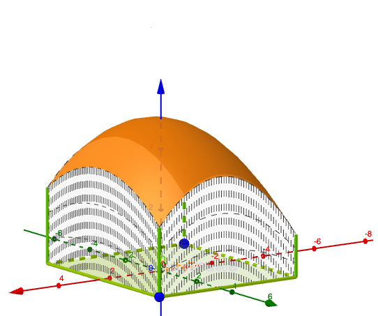
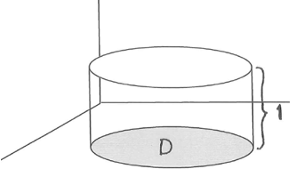
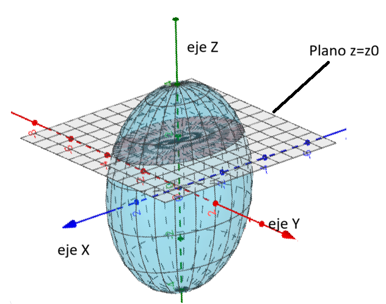

---

**Sesión 21. Integrales dobles: definición y propiedades.**

{width="80%" fig-align="center"}

+ [Notebook de la sesión en Colab]()

---

```{=latex}

  \frametitle{Tabla de contenidos}
  \tableofcontents

```

# Introducción


::: {.callout-note  icon=false}

\small

En la Sesión 13 dijimos que la integral de una función de una variable es mucho más que "el área bajo una gráfica": es una herramienta para pasar de lo microscópico (el valor de una cantidad en un punto) a lo macroscópico (el efecto combinado de esa cantidad en todo un intervalo). En esta sesión damos el mismo paso, pero para funciones de **dos variables** $f(x, y)$, cuyo dominio ya no es un intervalo sino una región del plano.

El ejemplo geométrico más intuitivo (y el que usaremos para construir todas las ideas) es el **volumen bajo una superficie**. Pero, igual que con el área en la Sesión 13, no es ni mucho menos la única aplicación: masa a partir de una densidad superficial, probabilidad de un suceso, media de una función, etc. La integración es una de las herramientas básicas del lenguaje científico.

Por otra parte, en esta sesión nos vamos a centrar inicialmente en la definición y las propiedades básicas. Es una sesión comparativamente teórica, y todavía no vamos a calcular ninguna integral doble de forma práctica: eso llegará en la próxima sesión, con el Teorema de Fubini.

\normalsize

:::

# El problema del volumen bajo una superficie

::: {.callout-note  icon=false}

## Volumen bajo una superficie e integral doble.

\small

Sea $z = f(x, y)$ una función continua en un **rectángulo** $R = [a, b]\times[c, d]$ del plano. Queremos calcular el **volumen del sólido** comprendido entre el rectángulo $R$ (suelo) y la gráfica de $f$ (techo), como en la figura y en esta [\textcolor{blue}{construcción GeoGebra}](https://www.geogebra.org/classic/pz5scgy6)

\hfil {width="35%"} \hfil

En este planteamiento del problema del volumen hacemos tres simplificaciones:  
$(1)$ La función $f$ es como hemos dicho continua.  
$(2)$ La base de la figura es un rectángulo (añadimos las paredes para visualizarlo).  
$(3)$ En $R$ es $f(x)\ge 0$.  

El volumen buscado se calcula con la **integral doble** $V = \iint_R f(x, y)\,dx\,dy$

\normalsize

:::


# Particiones y sumas de Riemann

::: {.callout-note  icon=false}

## Partición de un rectángulo

\small

Las **particiones** en dos dimensiones son divisiones $R$ en $m \times n$ **subrectángulos**:  
$(1)$ dividimos el intervalo $[a, b]$ $m$ con puntos $a = x_0 < x_1 < \cdots < x_m = b.$  
$(2)$ dividimos el intervalo $[c, d]$ con $n$ puntos $c = y_0 < y_1 < \cdots < y_n = d.$.  
Los subrectángulos son entonces 
$$\small R_{ij} = [x_{i-1}, x_i]\times[y_{j-1}, y_j]$$
con área $\Delta A_{ij} = \Delta x_i\, \Delta y_j = (x_i - x_{i-1})(y_j - y_{j-1})$.

$$
\begin{tikzpicture}[scale=0.35]
  \draw[thick] (0,0) rectangle (6,4);
  \foreach \x in {1,2,3,4,5} \draw[gray!70] (\x,0) -- (\x,4);
  \foreach \y in {1,2,3} \draw[gray!70] (0,\y) -- (6,\y);
  \fill[blue!15] (2,1) rectangle (3,2);
  \draw[blue, thick] (2,1) rectangle (3,2);
  \fill (2.4,1.65) circle (1.6pt);
  \node[below right] at (2.35,1.65) {\footnotesize $(x_{ij}^*, y_{ij}^*)$};
  \node at (2.5,0.5) {\footnotesize $R_{ij}$};
  \draw[-{Stealth[length=2.2mm]}] (-0.4,0) -- (6.8,0) node[right] {$x$};
  \draw[-{Stealth[length=2.2mm]}] (0,-0.4) -- (0,4.8) node[above] {$y$};
  \node[below] at (0,-0.05) {\footnotesize $a$};
  \node[below] at (6,-0.05) {\footnotesize $b$};
  \node[left] at (-0.05,0) {\footnotesize $c$};
  \node[left] at (-0.05,4) {\footnotesize $d$};
  \node[below] at (2,-0.05) {\footnotesize $x_{i-1}$};
  \node[below] at (3,-0.05) {\footnotesize $x_i$};
  \node[left] at (-0.05,1) {\footnotesize $y_{j-1}$};
  \node[left] at (-0.05,2) {\footnotesize $y_j$};
\end{tikzpicture}
$$
El **diámetro** de la partición es la longitud de la diagonal más larga de esos subrectángulos. 
\normalsize

:::

---

::: {.callout-note  icon=false}

## Suma de Riemann doble

\small

Los rectángulos de la partición nos dan las bases. Para las alturas, elegimos en cada subrectángulo $R_{ij}$ un punto $(x_{ij}^*, y_{ij}^*)$. La **suma de Riemann doble** asociada es
$$\small S = \sum_{i=1}^m\sum_{j=1}^n f(x_{ij}^*, y_{ij}^*)\, \Delta x_i\, \Delta y_j$$
Cada sumando $f(x_{ij}^*, y_{ij}^*)\, \Delta A_{ij}$ es el volumen de una "columna" o prisma de base $R_{ij}$ y altura $f(x_{ij}^*, y_{ij}^*)$. 
Como en la Sesión 13 tenemos una aproximación:
$$
\small \iint_R f(x, y)\,dx\,dy\approx \sum_{i=1}^m\sum_{j=1}^n f(x_{ij}^*, y_{ij}^*)\, \Delta x_i\, \Delta y_j
$$
y esperamos que esa aproximación sea cada vez mejor a medida que usamos particiones de diámetros más pequeños.
\normalsize

:::

::: {.callout-tip  appearance="minimal"}

\small

\textbf{\textcolor{blue}{Ejercicio 21A01.}} Sea $R = [0, 2]\times[0, 2]$ con la partición más sencilla posible, $m = n = 2$ (cuatro subrectángulos de lado 1), y $f(x, y) = x + y$. ¿Cuál es su diámetro? Usando como $(x_{ij}^*, y_{ij}^*)$ la esquina inferior izquierda de cada subrectángulo, calcula a mano la suma de Riemann $S$.

\normalsize

:::

# Sumas superiores e inferiores. La integral doble

::: {.callout-note  icon=false}

## Sumas superiores e inferiores

\small
Si $f$ es continua en $R$ (por el T. de Weierstrass), en cada subrectángulo $R_{ij}$ existen
$$m_{ij} = \min_{R_{ij}} f, \qquad M_{ij} = \max_{R_{ij}} f$$
Con ellos definimos la **suma inferior** y la **suma superior** de $f$ en $R$ con la partición $P$:
$$L(f, P) = \sum_{i,j} m_{ij}\,\Delta A_{ij}, \qquad U(f, P) = \sum_{i,j} M_{ij}\,\Delta A_{ij}$$
Sea cual sea la elección de los puntos $(x_{ij}^*, y_{ij}^*)$, siempre se cumple 
$$L(f,P) \leq \sum_{i=1}^m\sum_{j=1}^n f(x_{ij}^*, y_{ij}^*)\, \Delta x_i\, \Delta y_j \leq U(f,P)$$
\normalsize

:::

::: {.callout-tip  appearance="minimal"}

\small

\textbf{\textcolor{darkgreen}{Ejercicio 21C01.}} Usa el notebook de la sesión para repetir y visualizar el ejercicio 21A01.
\normalsize

:::

---

::: {.callout-note  icon=false}

## La integral doble sobre un rectángulo

\small

Si, al tomar particiones con subrectángulos cada vez más pequeños, la diferencia $U(f, P) - L(f, P)$ puede hacerse tan pequeña como se quiera, decimos que $f$ es **integrable** en $R$ y existe un único número, la **integral doble** de $f$ en $R$, que denotamos
$$\iint_R f(x, y)\, dx dy$$
tal que $L(f, P) \leq \displaystyle\iint_R f\, dxdy \leq U(f, P)$ para toda partición $P$. 

\normalsize

:::


::: {.callout-note  icon=false}

## Integrabilidad de funciones continuas. Conjuntos de medida 0.

\small

Como en el caso unidimensional, toda función continua en $R$ es integrable. Una función acotada en $R$ también es integrable si su conjunto de discontinuidades en $R$ es *pequeño*. ¿Qué queremos decir con esto? No podemos dar los detalles técnicos completos, pero esa idea incluye las uniones finitas de colecciones de puntos y curvas de nivel de funciones $C^1$. Se trata así de conjuntos *"sin área"*; técnicamente se denominan **conjuntos de medida cero** en $\mathbb R^2$.

\normalsize

:::

# Regiones generales

::: {.callout-note  icon=false}

## Integrales dobles sobre regiones generales

\small

A menudo necesitaremos integrar funciones usando como base una región *acotada* $D$ que no es un rectángulo. La idea, ilustrada en esta [\textcolor{blue}{construcción GeoGebra}](https://www.geogebra.org/classic/w8g4bxtd),   es tomar un rectángulo $R$ que contenga a $D$ y extender $f$ a todo $R$ definiéndo esta función:
$$\hat{f}(x, y) = \begin{cases}f(x, y)&(x, y)\in D\\0&(x, y)\notin D\end{cases}$$
Entonces **definimos**: $\displaystyle\iint_D f(x, y)\, dxdy \;\overset{\text{def}}=\; \iint_R f(x, y)\, dxdy$

La extensión  (que no depende de $R$) puede crear discontinuidades de $f$ en la frontera de $D$. Pero si esa frontera es de medida cero, $f$ seguirá siendo integrable en $R$ 
$$
\begin{tikzpicture}[scale=0.42]
  \draw[thick, dashed] (0,0) rectangle (6,4.2);
  \node[below left] at (0,0) {\footnotesize $R$};
  \draw[thick, fill=blue!12]
    plot [smooth cycle, tension=0.9] coordinates {
      (1.2,2.0) (1.6,3.2) (3.0,3.7) (4.6,3.3)
      (5.2,2.2) (4.6,1.0) (3.2,0.5) (1.8,0.9)
    };
  \node at (3.1,2.1) {\footnotesize $D$};
  \node[align=center] at (3.1,1.5) {\footnotesize $f(x,y)$};
  \node[align=center, text width=2.6cm] at (4.2,4) {\tiny $f$ extendida $= 0$ aquí};
  \draw[-{Stealth[length=1.8mm]}, gray] (4.25,3.9) -- (5.5,3);
\end{tikzpicture}
$$

\normalsize

:::

<!-- ::: {.callout-tip  appearance="minimal"} -->

<!-- \small -->

<!-- \textbf{\textcolor{firebrick}{Ejercicio 21B01.}} Si $f(x, y) \geq 0$ en la mitad de $D$ y $f(x,y)\le 0$, con los mismos valores absolutos, en la otra mitad, ¿qué puedes decir de $\displaystyle\iint_D f\,dA$ sin calcular nada? -->

<!-- \normalsize -->

<!-- ::: -->

# Propiedades de la integral doble

::: {.callout-note  icon=false}

## Propiedades básicas

\small

Sean $f, g$ integrables en $D$ y $a, b \in \mathbb{R}$:  
\quad

$(1)$ **Linealidad:** $\iint_D (a f + b g)\, dxdy = a\iint_D f\, dxdy + b \iint_D g\, dxdy$  
\quad

$(2)$ **Monotonía:** si $f(x,y) \leq g(x,y)$ en todo $D$, entonces $\iint_D f\, dxdy \leq \iint_D g\, dxdy$. En particular, si $0\le m \leq f(x,y) \leq M$ en $D$, entonces  

\qquad\qquad\qquad\qquad$m\cdot\text{Área}(D) \leq \iint_D f\, dxdy \leq M\cdot\text{Área}(D)$.  
\quad  

$(3)$ **Aditividad en el dominio:** si $D = D_1 \cup D_2$ y $D_1$, $D_2$ no se solapan (o como mucho comparten una frontera de medida cero), entonces  

\qquad\qquad\qquad\qquad$\iint_D f\, dxdy = \iint_{D_1} f\, dxdy + \iint_{D_2} f\, dxdy$  
\quad  

$(4)$ **Volumen con signo.** Si $f$ cambia de signo en $D$, al igual que en la Sesión 13, interpretamos $\iint_D f\, dxdy$ como *volumen con signo*:  
$-$ positivo donde $f > 0$ (sólido sobre el plano $XY$),  
$-$ negativo donde $f < 0$ (sólido bajo el plano $XY$).  

La integral es entonces la diferencia entre ambos volúmenes.

\normalsize

:::

---

::: {.callout-note  icon=false}

## Calculando áreas mediante integrales dobles. 

\small

Si tomamos $f(x,y) = 1$ (constante), estaremos usando un *techo* de altura fija 1.  Su volumen es así **numéricamente** igual al área de su base (el mismo número aunque uno sean $m^2$ y el otro $m^3$). Por tanto
$$\iint_D 1\, dxdy = \text{Área}(D)$$
El áreas de regiones planas acotadas (y frontera de medida cero) se reduce así al cálculo de integrales dobles. Este resultado se puede ver como una generalización del principio básico de cálculo de algunos volúmenes sencillos (de tipo *cilíndrico*): *área de la base por la altura*

Este es el primer ejemplo (desde luego, no el último) en el que vemos que la integral de la función constante 1 en un objeto nos da una cierta medida del **tamaño** del objeto.

\hfil {width="35%"} \hfil
\normalsize
:::

---

::: {.callout-note  icon=false}

## Principio de Cavalieri, volumen por secciones.

\small
El principio de [\textcolor{blue}{Cavalieri}](https://es.wikipedia.org/wiki/Bonaventura_Cavalieri) para el cálculo de volúmenes por secciones, que se illustra en esta [\textcolor{blue}{construcción GeoGebra}](https://www.geogebra.org/classic/jtyfrxkd) lleva un paso más allá está idea de *base por altura* y nos permite **reducir el cálculo de muchos volúmenes a integrales en una variable**.

Para calcular el volumen de un cuerpo sólido por secciones seguimos estos
pasos:  
$(1)$ Situamos el cuerpo sólido según nos interese y elegimos un eje, por ejemplo
el eje Z. Suponemos que el sólido queda comprendido entre $z_{min}$ y $z_{max}$.  
$(2)$ Cortamos el sólido en secciones con planos horizontales al eje X, es decir con
planos de ecuación $z = z_0$ y hallamos una fórmula del área $A = A (z_0)$ de esa sección.  
$(3)$ El volumen será $\small V = \int_{z_{\tiny min}}^{z_{\tiny max}} A(z)\, dz$.

\hfil {width="35%"} \hfil

En la próxima sesión veremos la importancia práctica de este método.
\normalsize
:::

---

::: {.callout-tip  appearance="minimal"}

\small

\textbf{\textcolor{blue}{Ejercicio 21A02.}} Sabiendo que $\displaystyle\iint_D f\, dxdy = 6$ y que $\text{Área}(D) = 4$, calcula $\displaystyle\iint_D (3f(x,y) - 2)\, dxdy$.

$\quad$

\textbf{\textcolor{blue}{Ejercicio 21A03.}} Utiliza el Principio de Cavalieri para calcular algunas fórmulas clásicas: (a) el volumen  de un cono recto de radio $r$ y altura $h$. (b) El volumen de una esfera de radio $r$. (c) El volumen de un elipsoide de ecuación 
$$\dfrac{x^2}{a^2} + \dfrac{y^2}{b^2} +\dfrac{z^2}{c^2} = 1$$
Este último apartado es más difícil, pero si lo piensas un poco deberías *adivinar* la respuesta antes de obtenerla.

\textbf{\textcolor{blue}{Ejercicio 21A04.}} Inventa una fórmula para el volumen del cuerpo sólido que se obtiene al girar alrededor del eje $X$ la gráfica de $y = f(x)$ en el intervalo $[a, b]$. Seguramente te vendrá bien antes consultar esta [\textcolor{blue}{construcción GeoGebra}](https://www.geogebra.org/classic/kte9yzfj). Usa la fórmula que has obtenido para calcular el volumen que se obtiene al girar alrededor del eje $X$ la gráfica de $y =\sqrt{x}$ para $0\le x\le 1$. 

\quad

\textbf{\textcolor{firebrick}{Hoja 3B GITI 25-26.}} Ejercicios 27 y 31.


<!-- \textbf{\textcolor{darkgreen}{Ejercicio 21C01.}} En el notebook de la sesión: (1) programa la suma de Riemann doble del Ejercicio 21A02 para una partición arbitraria $m \times n$ y compruébala con tu respuesta manual; (2) usa `scipy.integrate.dblquad` para obtener un valor de referencia de alta precisión de esa misma integral y compara con tu suma de Riemann al aumentar $m$ y $n$; (3) haz una gráfica 3D de la superficie junto con las columnas de la suma de Riemann para $m = n = 2$ y para $m = n = 20$. -->

\normalsize

:::
