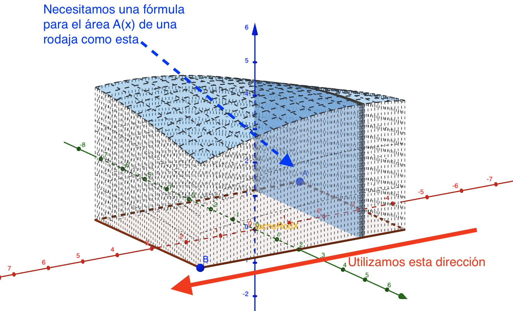
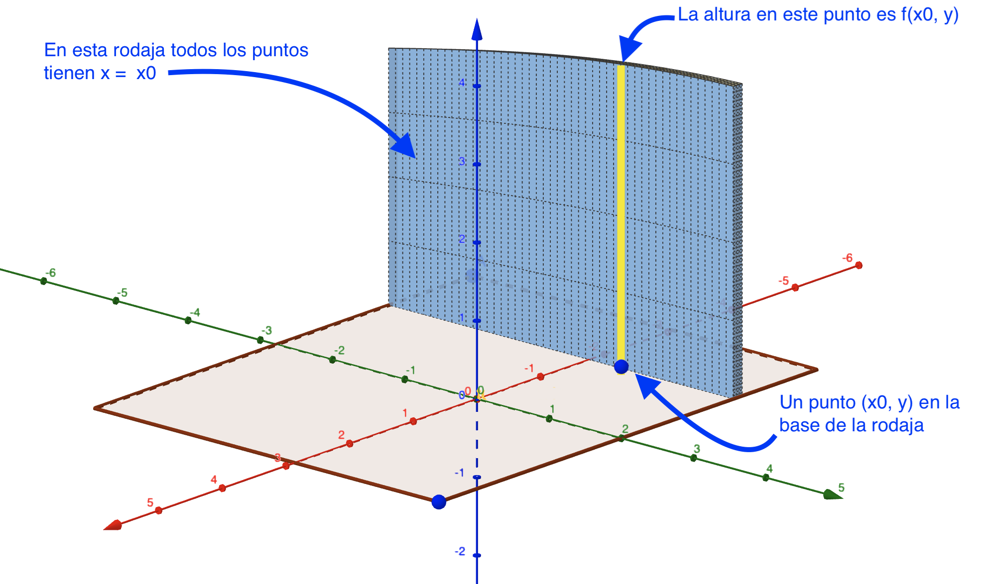
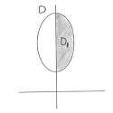
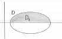
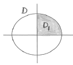

---

**Sesión 22. Teorema de Fubini.**

{width="80%" fig-align="center"}

<!-- + [Notebook de la sesión en Colab]() -->

---

```{=latex}

  \frametitle{Tabla de contenidos}
  \tableofcontents

```

# El Teorema de Fubini

::: {.callout-note  icon=false}

## Aplicando el Principio de Cavalieri

\small

En la Sesión 21 definimos la integral doble $\iint_R f(x, y)\,dxdy$ mediante sumas de Riemann, pero no obtuvimos ninguna forma práctica de calcularla. El Teorema de Fubini resuelve este problema: reduce el cálculo de una integral doble al cálculo de *dos integrales de una variable*, que podremos hacer usando la Regla de Barrow y calculando primitivas.

El Teorema de Fubini se puede ver como una aplicación del  *Principio de Cavalieri* de la sesión anterior. Supongamos que, como en la sesión anterior queremos calcular 
$$\iint_R f(x, y)\, dxdy$$
donde $R= [a,b]\times[c,d]$ es un rectángulo del plano $XY$ y $f(x, y)$ es una función que vamos a suponer continua en $R$ por simplicidad. Para facilitar la visualización suponemos $f(x, y)\ge 0$ en $R$, aunque esto no es imprescindible. 
Para ilustrar esta discusión usaremos esta [\textcolor{blue}{construcción GeoGebra}](https://www.geogebra.org/classic/bjajnwhu).  


\normalsize

:::

---

::: {.callout-note  icon=false}

## Expresando el área de una rodaja en este problema

\small

Aplicamos el Principio de Cavalieri en dirección paralela al eje $X$. En la siguiente figura elegimos un valor fijo $x = x_0$ con $a\le x_0\le b$ (recuerda,  $R= [a,b]\times[c,d]$). Queremos el área de la rodaja $A(x_0)$ para ese valor $x_0$.

\hfil {width="55%"} \hfil

Si sabemos encontrar una expresión general de $A(x)$ (que sirva para cualquier valor de $x$, no sólo un valor $x_0$ concreto) entonces el principio de Cavalieri nos permitirá concluir que:
$$\small
\iint_R f(x, y)\, dxdy = \int_{x = a}^{x = b}A(x)dx
$$
**Nota:** nuestra notación añade la variable al límite de integración.
\normalsize

:::

---

::: {.callout-note  icon=false}

## Integrales iteradas 

\small

En esta segunda figura hemos eliminado el techo y las paredes verticales para concentrarnos en el área de la rodaja $A(x)$. 

\hfil {width="60%"} \hfil

Recuerda que el techo de la figura es la gráfica de $z = f(x, y)$. Y los puntos en la base de la rodaja son todos de la forma $(x_0, y)$. Así que la rodaja en $x = x_0$ es la gráfica de la función $f_{x_0}(y) = f(x_0, y)$ para $c\le y\le d$. Esta función sólo depende de $y$ y su área es, como sabemos
$$A(x_0) = \int_{y = c}^{y = d}f(x_0, y)\, dy$$

\normalsize

:::

---

::: {.callout-note  icon=false}

## Teorema de Fubini

\small

Uniendo todas las piezas, el Principio de Cavalieri nos da este **Teorema de Fubini** en un rectángulo:
$$\small
\iint_R f(x, y)\, dxdy = \overbrace{\int_{x = a}^{x = b}\left(
\underbrace{\int_{y = c}^{y = d}f(x, y)\, dy}_{\text{integral interior}}
\right)\, dx}^{\text{integral exterior}}
$$
Hemos añadido paréntesis y llaves para enfatizar la estructura de **integrales iteradas** que caracteriza al Teorema de Fubini:

$(1)$ En la integral interior (que haremos en primer lugar) integramos en $y$ **manteniendo la $x$ constante** (estamos en una rodaja de $x$ fijo).  
$(2)$ Esa integral nos dará una fórmula $A(x)$ (la $y$ desaparece) que luego **integramos en $x$ en la integral exterior**. 

Imaginamos que la analogía con las derivadas parciales no se te escapa. Aquí primero integramos tratando a la $x$ como una constante. 


\normalsize

:::

---

::: {.callout-note  icon=false}

## Orden de integración

\small

Hemos obtenido el Teorema de Fubini aplicando el Principio de Cavalieri en la dirección del eje $X$. Pero si hubiéramos usado el eje $Y$ obtendríamos u¡otra expresión del Teorema:
$$\small
\iint_R f(x, y)\, dxdy = 
\int_{y = c}^{y = d}\left(\int_{x = a}^{x = b}f(x, y)\, dx\right)\, dy
$$
Como ves, en este caso en la integral interior trataremos a $y$ como una constante (y usamos la Regla de Barrow para buscar una **primitiva en x** de $f(x, y)$. El resultado de esa integral interior es una fórmula del área $A(y)$ de una rodaja perpendicular al eje $Y$. Al integrarla desde $y = c$ a $y = d$ obtendremos el mismo valor que con el otro orden de integración.

Enseguida veremos que, aunque el Teorema garantiza que el resultado no depende del orden de integración, *eso no significa que ambos caminos sean igual de fáciles.* 

\normalsize

:::

---

::: {.callout-note  icon=false}

## Un ejemplo sencillo

\small
Sea $R = [0,1]\times[0,2]$ y $f(x, y) = x + y$ y calculemos 
$$\int_0^1\left(\int_0^2 (x+y)\, dy\right) dx$$ 
Primero, con $x$ fijo, integramos en $y$:
$$A(x) = \int_0^2 (x + y)\, dy = \Big[xy + \tfrac{y^2}{2}\Big]_{y=0}^{y=2} = 2x + 2$$
Ahora integramos $A(x)$ en $x$ $\displaystyle\int_0^1 (2x + 2)\, dx = \Big[x^2 + 2x\Big]_0^1 = 3$.  
¿Y si integramos en el otro orden? Es decir, hacemos:
$$\int_0^2\left(\int_0^1  (x+y)\, dx\right) dy$$ 
La integral interior es $A(y) = \tfrac12 + y$, con lo que 
$$\int_0^2\left(\tfrac12 + y\right) dy = 1 + 2 = 3$$

\normalsize
:::


# Regiones verticalmente simples y horizontalmente simples

::: {.callout-note  icon=false}

## Regiones verticalmente simples

\small

Al igual que en la sesión anterior, nuestro siguiente objetivo es poder extender el Teorema de Fubini a regiones de integración más generales que los rectángulos. 

Una región $D$ es **verticalmente simple** si existen $a < b$ y funciones continuas $\phi_1(x) \leq \phi_2(x)$ en $[a,b]$ tales que
$$D = \{(x,y) : a \leq x \leq b,\ \phi_1(x) \leq y \leq \phi_2(x)\}$$
\begin{center}
\begin{tikzpicture}[
    scale=0.55,
    >=Stealth,
    axis/.style={->, thick, black!80},
    curve/.style={thick, blue!65!black},
    region/.style={fill=blue!10},
    slice/.style={green!45!black, line width=0.45pt, opacity=0.65},
    intpath/.style={<->, red!85!black, very thick},
    intproj/.style={dotted, blue!65!black, line width=0.7pt},
    proj/.style={dashed, gray!80, line width=0.6pt},
    lbl/.style={font=\small\sffamily}
]

% =========================================================================
% DIAGRAM 1: Region strictly above the x-axis with two vertical segments
% =========================================================================
\begin{scope}[xshift=0cm]
    % Axes
    \draw[axis] (-0.4, 0) -- (3.8, 0) node[right, lbl] {$x$};
    \draw[axis] (0, -0.4) -- (0, 2.8) node[above, lbl] {$y$};

    % Shaded Region D with vertical integration slices clipped inside
    \begin{scope}
        \path[clip] 
            (0.8, 1.05) .. controls (1.4, 1.1) and (1.7, 0.75) .. (2.2, 0.78)
                        .. controls (2.6, 0.8) and (2.8, 1.0) .. (3.2, 0.98)
            -- (3.2, 2.15)
            .. controls (2.8, 1.95) and (2.5, 1.75) .. (2.1, 1.8)
            .. controls (1.6, 1.85) and (1.3, 2.2) .. (0.8, 1.95)
            -- cycle;
        \fill[region] (0.7, 0.6) rectangle (3.3, 2.3);
        \foreach \x in {0.98, 1.16, ..., 3.12} {
            \draw[slice] (\x, 0.6) -- (\x, 2.3);
        }
    \end{scope}

    % Bounding Curves: y = \varphi_1(x) and y = \varphi_2(x)
    \draw[curve, name path=bot1] (0.8, 1.05) .. controls (1.4, 1.1) and (1.7, 0.75) .. (2.2, 0.78)
                              .. controls (2.6, 0.8) and (2.8, 1.0) .. (3.2, 0.98);
    \draw[curve, name path=top1] (0.8, 1.95) .. controls (1.3, 2.2) and (1.6, 1.85) .. (2.1, 1.8)
                              .. controls (2.5, 1.75) and (2.8, 1.95) .. (3.2, 2.15);

    % Left and right vertical boundary segments of D
    \draw[curve] (0.8, 1.05) -- (0.8, 1.95);
    \draw[curve] (3.2, 0.98) -- (3.2, 2.15);

    % Representative inner integration slice at x_0 = 1.35
    \path[name path=v1] (1.35, 0) -- (1.35, 2.5);
    \path[name intersections={of=bot1 and v1, by=p1bot}];
    \path[name intersections={of=top1 and v1, by=p1top}];
    \draw[intproj] (1.35, 0) -- (p1bot);
    \draw[intpath] (p1bot) -- (p1top);
    \fill[red!85!black] (1.35, 0) circle (1.6pt);
    \node[below, lbl, text=blue!65!black] at (1.35, -0.02) {$x_0$};

    % Dashed projection lines to x-axis
    \draw[proj] (0.8, 0) -- (0.8, 1.05);
    \draw[proj] (3.2, 0) -- (3.2, 0.98);

    % Axis labels
    \node[below, lbl] at (0.8, 0) {$a$};
    \node[below, lbl] at (3.2, 0) {$b$};

    % Region and function labels (with subtle background fill so slices don't cross text)
    \node[lbl, font=\normalsize, fill=blue!10, inner sep=2pt] at (2.0, 1.42) {$D$};
    \node[above, lbl] at (2.05, 1.95) {$\varphi_2(x)$};
    \node[below, lbl] at (2.05, 0.75) {$\varphi_1(x)$};
\end{scope}

% =========================================================================
% DIAGRAM 2: Lens-shaped region crossing the x-axis (pinched at endpoints)
% =========================================================================
\begin{scope}[xshift=5.2cm]
    % Axes
    \draw[axis] (-0.4, 0) -- (3.8, 0) node[right, lbl] {$x$};
    \draw[axis] (0, -0.9) -- (0, 2.8) node[above, lbl] {$y$};

    % Shaded Region D with vertical integration slices clipped inside
    \begin{scope}
        \path[clip]
            (0.7, 1.05) .. controls (1.15, 1.05) and (1.3, -0.55) .. (2.0, -0.55)
                        .. controls (2.65, -0.55) and (2.8, 0.45) .. (3.3, 0.65)
            .. controls (2.8, 0.85) and (2.65, 2.05) .. (2.0, 2.05)
            .. controls (1.3, 2.05) and (1.15, 1.05) .. (0.7, 1.05)
            -- cycle;
        \fill[region] (0.6, -0.7) rectangle (3.4, 2.2);
        \foreach \x in {0.88, 1.06, ..., 3.22} {
            \draw[slice] (\x, -0.7) -- (\x, 2.2);
        }
    \end{scope}

    % Bounding Curves: y = \varphi_1(x) and y = \varphi_2(x)
    \draw[curve, name path=bot2] (0.7, 1.05) .. controls (1.15, 1.05) and (1.3, -0.55) .. (2.0, -0.55)
                              .. controls (2.65, -0.55) and (2.8, 0.45) .. (3.3, 0.65);
    \draw[curve, name path=top2] (0.7, 1.05) .. controls (1.15, 1.05) and (1.3, 2.05) .. (2.0, 2.05)
                              .. controls (2.65, 2.05) and (2.8, 0.85) .. (3.3, 0.65);

    % Representative inner integration slice at x_0 = 1.15
    \path[name path=v2] (1.15, -0.7) -- (1.15, 2.2);
    \path[name intersections={of=bot2 and v2, by=p2bot}];
    \path[name intersections={of=top2 and v2, by=p2top}];
    \draw[intproj] (1.15, 0) -- (p2bot);
    \draw[intpath] (p2bot) -- (p2top);
    \fill[red!85!black] (1.15, 0) circle (1.6pt);

    % Endpoint dots
    \fill[blue!65!black] (0.7, 1.05) circle (1.5pt);
    \fill[blue!65!black] (3.3, 0.65) circle (1.5pt);

    % Dashed projection lines to x-axis
    \draw[proj] (0.7, 0) -- (0.7, 1.05);
    \draw[proj] (3.3, 0) -- (3.3, 0.65);

    % Axis labels
    \node[below, lbl] at (0.7, 0) {$a$};
    \node[below, lbl] at (3.3, 0) {$b$};

    % Region and function labels
    \node[lbl, font=\normalsize, fill=blue!10, inner sep=2pt] at (2.0, 0.85) {$D$};
    \node[above, lbl] at (2.0, 2.08) {$\varphi_2(x)$};
    \node[below, lbl] at (2.0, -0.58) {$\varphi_1(x)$};
\end{scope}

% =========================================================================
% DIAGRAM 3: Region entirely below the x-axis (vertical left, pinched right)
% =========================================================================
\begin{scope}[xshift=10.4cm, yshift=1.9cm]
    % Axes (x-axis positioned near the top)
    \draw[axis] (-0.4, 0) -- (3.8, 0) node[right, lbl] {$x$};
    \draw[axis] (0, -2.5) -- (0, 0.8) node[above, lbl] {$y$};

    % Shaded Region D with vertical integration slices clipped inside
    \begin{scope}
        \path[clip]
            (0.8, -2.15) .. controls (1.8, -2.05) and (2.5, -1.75) .. (3.2, -1.45)
            .. controls (2.5, -1.35) and (1.8, -0.65) .. (0.8, -0.75)
            -- cycle;
        \fill[region] (0.7, -2.3) rectangle (3.3, -0.6);
        \foreach \x in {0.98, 1.16, ..., 3.12} {
            \draw[slice] (\x, -2.3) -- (\x, -0.6);
        }
    \end{scope}

    % Bounding Curves: y = \varphi_1(x) and y = \varphi_2(x)
    \draw[curve, name path=bot3] (0.8, -2.15) .. controls (1.8, -2.05) and (2.5, -1.75) .. (3.2, -1.45);
    \draw[curve, name path=top3] (0.8, -0.75) .. controls (1.8, -0.65) and (2.5, -1.35) .. (3.2, -1.45);

    % Representative inner integration slice at x_0 = 2.65
    \path[name path=v3] (2.65, -2.3) -- (2.65, 0);
    \path[name intersections={of=bot3 and v3, by=p3bot}];
    \path[name intersections={of=top3 and v3, by=p3top}];
    \draw[intproj] (2.65, 0) -- (p3top);
    \draw[intpath] (p3bot) -- (p3top);
    \fill[red!85!black] (2.65, 0) circle (1.6pt);

    % Left vertical boundary segment and right endpoint dot
    \draw[curve] (0.8, -2.15) -- (0.8, -0.75);
    \fill[blue!65!black] (3.2, -1.45) circle (1.5pt);

    % Dashed projection lines up to x-axis
    \draw[proj] (0.8, 0) -- (0.8, -0.75);
    \draw[proj] (3.2, 0) -- (3.2, -1.45);

    % Axis labels (placed above the x-axis to avoid overlapping projections)
    \node[above, lbl] at (0.8, 0) {$a$};
    \node[above, lbl] at (3.2, 0) {$b$};

    % Region and function labels
    \node[lbl, font=\normalsize, fill=blue!10, inner sep=2pt] at (1.55, -1.45) {$D$};
    \node[above, lbl] at (2.05, -0.82) {$\varphi_2(x)$};
    \node[below, lbl] at (2.15, -1.95) {$\varphi_1(x)$};
\end{scope}
\end{tikzpicture}
\end  {center}
El nombre proviene de que, para cada $x_0$ fijo, un **segmento vertical** recorre $D$ desde $y = \phi_1(x_0)$ hasta $y = \phi_2(x_0)$
\normalsize

:::


---

::: {.callout-note  icon=false}

## Teorema de Fubini en regiones verticalmente simples

\small

Si  la región $D$ es verticalmente simple con 
$$a\le x\le b\text{ y para cada uno de esos }x\text{ es } \phi_1(x)\le y\le \phi_2(x)$$
entonces:
$$\iint_D f(x, y)\, dxdy = 
\int_{x = a}^{x=b}\left(\int_{y = \phi_1(x)}^{y = \phi_2(x)} f(x,y)\, dy\right) dx
$$

\normalsize

:::

::: {.callout-tip  appearance="minimal"}

\small

\textbf{\textcolor{blue}{Ejercicio 22A01.}} Sea $D$ el triángulo de vértices $(0,0)$, $(1,0)$ y $(1,1)$. Dibújalo y escríbelo como región verticalmente simple. Es decir, identifica $a, b$ y también $\phi_1(x), \phi_2(x)$. Usa esto para calcular $\displaystyle\iint_D xy\, dxdy$.

$\quad$

\textbf{\textcolor{blue}{Ejercicio 22A02.}} Sea $D$ la región comprendida entre las parábolas $y = x^2$ e $y = 2 - x^2$. ¿Es verticalmente simple? Calcula $\displaystyle\iint_D y\, dxdy$.

\normalsize

:::

$$\textcolor{red}{\boxed{\text{\large ¡DIBUJA SIEMPRE LAS REGIONES EN ESTOS EJERCICIOS!}}}$$


---

::: {.callout-note  icon=false}

## Regiones horizontalmente simples

\small
De forma análoga, $D$ es **horizontalmente simple** si existen $c < d$ y funciones continuas $h_1(y) \leq h_2(y)$ en $[c,d]$ tales que
$$D = \{(x,y) : c \leq y \leq d,\ \psi_1(y) \leq x \leq \psi_2(y)\}$$
Ahora, para cada valor $y_0$ entre $c$ y $d$,  es un **segmento horizontal**, a altura $y_0$ fija, el que recorre $D$ desde $x=\psi_1(y_0)$ hasta $x=\psi_2(y_0)$.
$$
\begin{tikzpicture}[scale=0.42]
  \draw[-{Stealth[length=2mm]}] (-0.5,0) -- (6,0) node[right] {\scriptsize$x$};
  \draw[-{Stealth[length=2mm]}] (0,-0.5) -- (0,5.3) node[above] {\scriptsize$y$};
  \fill[blue!12]
    plot [smooth, tension=0.8] coordinates {(2.3,0.8) (1.6,2.0) (2.0,3.2) (1.7,4.3) (2.6,5.0)}
    -- plot [smooth, tension=0.8] coordinates {(2.6,5.0) (4.4,4.4) (4.0,3.2) (4.6,2.0) (2.3,0.8)}
    -- cycle;
  \draw[thick] plot [smooth, tension=0.8] coordinates {(2.3,0.8) (1.6,2.0) (2.0,3.2) (1.7,4.3) (2.6,5.0)};
  \draw[thick] plot [smooth, tension=0.8] coordinates {(2.3,0.8) (4.6,2.0) (4.0,3.2) (4.4,4.4) (2.6,5.0)};
  \draw[dashed] (0,3.2) -- (5.3,3.2);
  \draw[very thick, red] (2.0,3.2) -- (4.0,3.2);
  \fill (2.0,3.2) circle (2.6pt);
  \fill (4.0,3.2) circle (2.6pt);
  \node at (2.0,2.2) {\scriptsize $D$};
  \node[left] at (0,0.8) {\scriptsize $c$};
  \node[left] at (0,5.0) {\scriptsize $d$};
  \node[left] at (-0.05,3.2) {\scriptsize $y_0$};
  \node[above left] at (2.85,3.3) {\scriptsize $\psi_1(y)$};
  \node[above right] at (4.1,3.3) {\scriptsize $\psi_2(y)$};
\end{tikzpicture}
$$
El Teorema de Fubini, para una región horizontalmente simple dice: 
$$\iint_D f\, dxdy = \int_{y = c}^{y = d}\left(\int_{x = \psi_1(y)}^{x = \psi_2(y)} f(x,y)\, dx\right) dy$$


\normalsize

:::

---

::: {.callout-tip  appearance="minimal"}

\small

\textbf{\textcolor{blue}{Ejercicio 22A03.}} Vuelve a hacer el ejercicio 22A01, pero ahora considerando al triángulo $T$ como una región horizontalmente simple. ¿Puedes hacer lo mismo en el 22A02?

\textbf{\textcolor{blue}{Ejercicio 22A04.}} Calcula 
$$\iint_D e^{y^2}\, dxdy$$
siendo $D$ la región del plano limitada por el eje $Y$, la recta $y = 2$ y la recta $y = \frac{x}{2}$.

\textbf{\textcolor{firebrick}{Ejercicios Hoja 11B GITI 25-26.} Ejercicios 3 a 5, 8 y 9.}

\normalsize

:::

# Simetrías en la integral doble

::: {.callout-note  icon=false}

### Simetría respecto del eje $Y$

\small
Supongamos que el recinto $D$ es simétrico **respecto del eje $Y$** (como en la figura).  

$\bullet$ Entonces si la función es **par en $x$**, es decir $f(-x, y) = f(x, y)$, para todo $(x,y) \in D$. Entonces
$$\small\iint_D f(x, y)\, dxdy = 2 \iint_{D_1} f(x, y)\, dxdy , \quad$$
siendo $D_1$ la mitad de $D$ en el semiplano derecho $x \ge 0$ (sombreado en la figura).

$\bullet$ Pero si la función es **impar en $x$**, es decir $f(-x, y) = -f(x, y)$, para todo $(x,y) \in D$, entonces
$$\small\iint_D f(x, y)\, dxdy = 0$$
\hfil {width="15%" fig-align="center"}\hfil 

\normalsize

:::

---

::: {.callout-note  icon=false}

### Simetría respecto del eje $X$

\small
Supongamos ahora que el recinto $D$ es simétrico **respecto del eje $X$** (como en la figura).  

$\bullet$ Entonces si la función es **par en $y$**, es decir $f(x, -y) = f(x, y)$, para todo $(x,y) \in D$. Entonces
$$\small\iint_D f(x, y)\, dxdy = 2 \iint_{D_1} f(x, y)\, dxdy , \quad$$
siendo $D_1$ la mitad de $D$ en el semiplano superior $y \ge 0$ (sombreado en la figura).

$\bullet$ Pero si la función es **impar en $y$**, es decir $f(x, -y) = -f(x, y)$, para todo $(x,y) \in D$, entonces
$$\small\iint_D f(x, y)\, dxdy = 0$$
\hfil {width="25%" fig-align="center"}\hfil 

\normalsize

:::


---

::: {.callout-note  icon=false}

### Simetría respecto de ambos ejes

\small
Supongamos ahora que el recinto $D$ es simétrico **respecto de ambos ejes** (como en la figura).  

$\bullet$ Entonces si la función es **par en $x$ y también en $y$**, es decir 
$$\begin{cases}
f(x, -y) = f(x, y)\\[2mm]
f(-x, y) = f(x, y)
\end{cases}
$$
para todo $(x,y) \in D$. Entonces
$$\small\iint_D f(x, y)\, dxdy = 4 \iint_{D_1} f(x, y)\, dxdy, \quad$$
siendo $D_1$ la parte de $D$ en el primer cuadrante (sombreado en la figura).

\hfil {width="15%" fig-align="center"}\hfil 

\normalsize

:::

---

$$\textcolor{red}{\boxed{\text{\,\,\large LA SIMETRÍA SIEMPRE COMBINA REGIÓN + FUNCIÓN\,\,}}}$$

::: {.callout-tip  appearance="minimal"}

\small

\textbf{\textcolor{blue}{Ejercicio 22A05.}} Calcula 
$$\iint_D x^3y^2\, dxdy$$
siendo 
$$D =\{(x, y) \,/\, \dfrac{x^2}{4} + \dfrac{y^2}{9}\le 1 \}$$ 

\normalsize

:::


